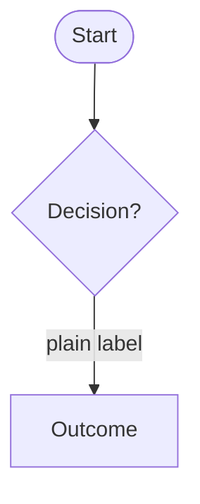

# Feature Docs — Template

> Copy this file to `docs/features/<feature>.md` when documenting a new feature.
> Delete this instruction block and the `<!-- guidance -->` comments once filled in.

---

# <Feature Name>

> **Status:** ✅ Implemented | 🚧 In progress | 🧪 Experimental
> **Last updated:** YYYY-MM-DD

## 1. Summary

<!-- 1–2 sentences: what this feature does for the user and why it exists. -->

## 2. Entry points & navigation

<!-- How does the user reach this feature? Which routes/tabs/buttons open it? Where does it go on exit? -->

- **In:**
- **Out:**

## 3. Key files

<!-- Link every file that implements the feature. Use workspace-relative links, no backticks. -->

| Layer | File |
| ----- | ---- |
| Page(s) | |
| Cubit + states | |
| Service | |
| Source | |
| Model(s) | |
| Controls / widgets | |
| Localization keys | prefix: `<prefix>*` |

## 4. Data model & Firestore

<!-- Firestore path(s), field table (name / type / meaning), and any invariants. Omit if the feature has no persistence. -->

## 5. Cubit states

<!-- Table of the states this feature's cubit(s) emit and what the UI does for each. -->

| State | Emitted when | UI response |
| ----- | ------------ | ----------- |

## 6. User workflows

<!--
HOUSE STYLE — every workflow gets BOTH:
  1. A mermaid diagram (flowchart TD or sequenceDiagram)
  2. A short "In plain English" numbered list

Diagram conventions:
  - Rounded nodes ([( )]) for start/end.
  - Plain-language edge labels ("No history yet", not "empty").
  - Collapse multi-step boxes; annotate with   instead of chaining tiny boxes.
  - Prefer sequenceDiagram for cross-layer flows (UI → Cubit → Service → Firestore).
-->

### <Workflow name>

**In plain English:**

1.

## 7. Business rules & edge cases

<!-- The non-obvious logic: date math, guards, permission checks, retry/dismissal policy, failure degradation, etc. -->

## 8. Tests

<!-- Link the test files that cover this feature and note any coverage gaps. -->

| Test file | Covers |
| --------- | ------ |

## 9. Known limitations & improvement candidates

<!-- Honest caveats + ideas for future work. Keep this current — it is the backlog seed. -->
