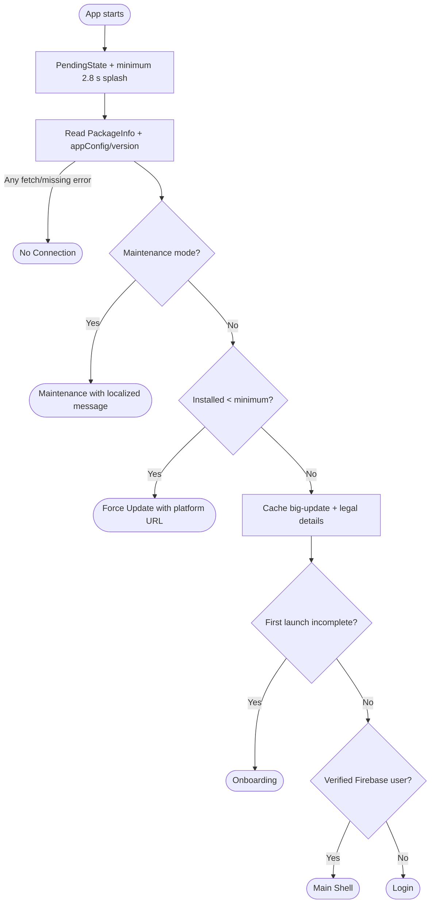
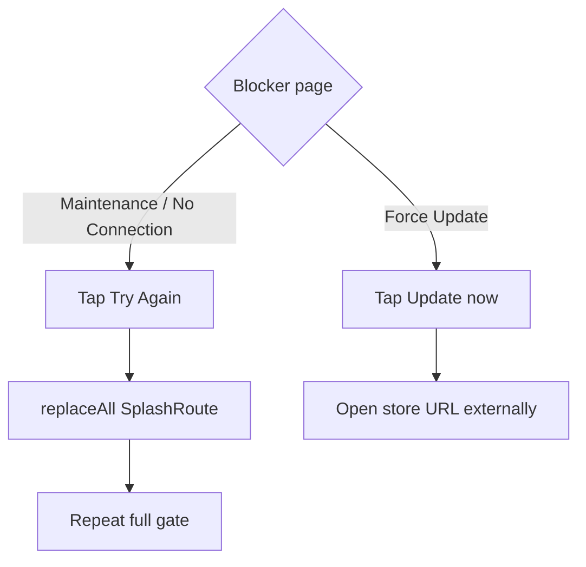
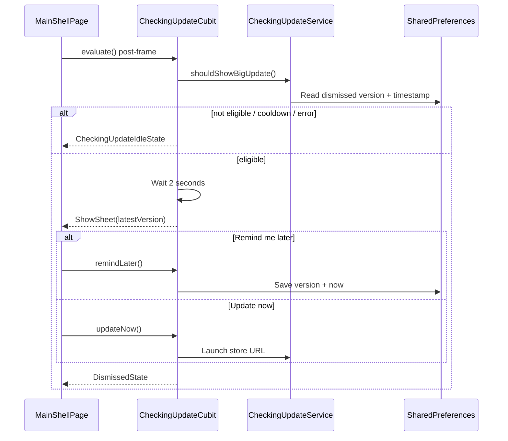

# App version gate & update prompts

> **Status:** ✅ Implemented
> **Last updated:** 2026-07-22

## 1. Summary

A cold-launch gate fetches public remote app configuration before onboarding/auth and routes to
maintenance, force-update, no-connection, onboarding, Login, or Main Shell. After a successful
gate, a separate soft “big update” flow may show a delayed, snoozable bottom sheet in Main Shell.

## 2. Entry points & navigation

- **Cold launch:** `/` → `SplashPage` → exactly one terminal `replaceAll` destination.
- **Retry:** Maintenance and No Connection replace the stack with `SplashRoute` to rerun everything.
- **Force update:** Update button launches the platform store URL externally; there is no bypass.
- **Soft update:** `MainShellPage.initState` calls `CheckingUpdateCubit.evaluate()` post-frame.

## 3. Key files

| Layer | File |
| ----- | ---- |
| Splash page/cubit | [splash_page.dart](../../lib/presentation/pages/splash/splash_page.dart) · [splash_cubit.dart](../../lib/cubit/splash/splash_cubit.dart) · [splash_states.dart](../../lib/cubit/splash/splash_states.dart) |
| Blocker pages | [maintenance_page.dart](../../lib/presentation/pages/maintenance/maintenance_page.dart) · [force_update_page.dart](../../lib/presentation/pages/force_update/force_update_page.dart) · [no_connection_page.dart](../../lib/presentation/pages/no_connection/no_connection_page.dart) |
| Config source | [app_config_service.dart](../../lib/service/app_config/app_config_service.dart) · [app_config_source.dart](../../lib/data/remote/app_config/app_config_source.dart) · [app_config_dto.dart](../../lib/data/remote/app_config/app_config_dto.dart) |
| Version logic/cache | [version_comparator.dart](../../lib/presentation/helpers/version_comparator.dart) · [app_version_status.dart](../../lib/core/app_version_status.dart) |
| Soft-update flow | [checking_update_cubit.dart](../../lib/cubit/checking_update/checking_update_cubit.dart) · [checking_update_service.dart](../../lib/service/checking_update/checking_update_service.dart) · [big_update_bottom_sheet.dart](../../lib/presentation/controls/big_update_bottom_sheet.dart) |
| Shell integration | [main_shell_page.dart](../../lib/presentation/pages/main_shell/main_shell_page.dart) |
| Localization keys | prefixes: `maintenance*`, `forceUpdate*`, `noConnection*`, `update*` |

## 4. Data model & Firestore

**Public-read path:** `appConfig/version`

| Field | Type | Meaning/default |
| ----- | ---- | --------------- |
| `minRequiredVersion` | String | Minimum allowed installed version; DTO fallback `0.0.0` |
| `latestVersion` | String | Latest store version; fallback `0.0.0` |
| `maintenanceMode` | Bool | Global blocker; fallback false |
| `maintenanceMessages` | Map<String,String> | Localized blocker copy |
| `androidStoreUrl` / `iosStoreUrl` | String | Platform-specific external destination |
| `termsUrls` / `privacyUrls` | Map<String,String> | Legal URL maps cached for Register/Settings |
| `termsVersion` / `privacyVersion` | String | Revision IDs stored with registration consent |

`AppVersionStatus` is an in-memory lazy singleton populated only on the successful non-blocked
path. Soft-update dismissal is local `SharedPreferences`:

- `big_update_dismissed_version`
- `big_update_dismissed_at_ms`

## 5. Cubit states

### Splash

| State | Outcome |
| ----- | ------- |
| `PendingState` | Splash animation/config gate in progress |
| `SplashNavigateMaintenanceState(message)` | Maintenance blocker |
| `SplashNavigateForceUpdateState(current, required, storeUrl)` | Mandatory update blocker |
| `SplashNavigateNoConnectionState` | Package/config fetch failed or config document missing |
| `SplashNavigateOnboardingState` | Gate passed; local first-launch flag still false/not complete |
| `SplashNavigateMainShellState` | Gate passed; returning verified Firebase user |
| `SplashNavigateLoginState` | Gate passed; signed out or unverified Firebase session |

### Checking update

| State | Outcome |
| ----- | ------- |
| `CheckingUpdateIdleState` | No prompt, cooldown active, or evaluation failed |
| `CheckingUpdateShowSheetState(latestVersion)` | Main Shell presents bottom sheet |
| `PendingState` | Update-now/remind-later action in progress |
| `CheckingUpdateDismissedState` | Action completed; sheet remains closed |

## 6. User workflows

### 6.1 Cold-launch classification

**In plain English:**

1. `SplashCubit.start()` runs the minimum delay and navigation resolution concurrently.
2. Package metadata and Firestore config are both mandatory; any exception routes to No Connection.
3. Maintenance wins over all version/auth decisions and resolves copy by locale with English fallback in the model.
4. Below-minimum versions receive the Android or iOS store URL.
5. The successful path caches soft-update eligibility and legal metadata, then checks onboarding before auth.
6. Only a verified Firebase session can cold-launch directly into Main Shell.

### 6.2 Retry and force update

**In plain English:**

1. Retry clears the blocker stack and reruns package/config/maintenance/version/onboarding/auth decisions.
2. Force Update has no Continue action; it delegates to `url_launcher` with the already-resolved store URL.

### 6.3 Soft big-update prompt

**In plain English:**

1. A “big jump” means major increased or same-major minor increased by at least two; patch and one-step minor updates are silent.
2. Eligible prompts wait two seconds so the shell paints first.
3. Remind Later stores a three-day cooldown for the current latest version.
4. A different latest version bypasses the previous cooldown.
5. Update Now launches externally and does not store a dismissal.
6. Preference/launcher failures are swallowed; the soft prompt never blocks app use.

## 7. Business rules & edge cases

- `VersionComparator` is intentionally minimal: missing/non-numeric parts become zero; Flutter `+build` suffix is stripped; prerelease SemVer ordering is unsupported.
- `AppVersionStatus` is not populated on maintenance, force-update, or fetch-failure paths.
- Legal URL resolution is requested locale → English remote entry → hardcoded locale fallback.
- No Connection conflates network, permission, package-info, malformed/missing config, and mapping failures.
- Maintenance and force-update decisions are cold-launch checks; the running shell does not live-subscribe to config changes.
- Soft-update evaluation catches every error and becomes idle.
- The 2.8 s Splash and 2 s prompt delays are constants but test-overridable where needed.

## 8. Tests

| Test file | Covers |
| --------- | ------ |
| [splash_cubit_test.dart](../../test/cubit/splash/splash_cubit_test.dart) | maintenance/version/platform/network paths, onboarding/auth decisions, verified-session requirement, cache population, minimum delay |
| [version_comparator_test.dart](../../test/presentation/helpers/version_comparator_test.dart) | numeric comparison and big-jump classification |
| [checking_update_service_test.dart](../../test/service/checking_update/checking_update_service_test.dart) | eligibility and per-version three-day cooldown |
| [checking_update_cubit_test.dart](../../test/cubit/checking_update/checking_update_cubit_test.dart) | presentation delay, idle/show/dismiss actions and swallowed failures |
| [main_shell_page_test.dart](../../test/presentation/pages/main_shell/main_shell_page_test.dart) | shell-level update-prompt integration |

**Coverage gaps:** Firestore app-config source/mapper, blocker page buttons, external URL launch, legal cache fallbacks in this flow, and full cold-launch router integration.

## 9. Known limitations & improvement candidates

- Treating every config failure as “No connection” can mislead users; introduce typed missing/invalid/permission states or observability.
- Minimal version parsing does not support prerelease semantics such as `2.0.0-beta.1`.
- Maintenance/force-update cannot activate while the app remains open.
- Soft-update launcher failure closes the sheet without feedback.
- Snooze is device-local, not account-synced.
