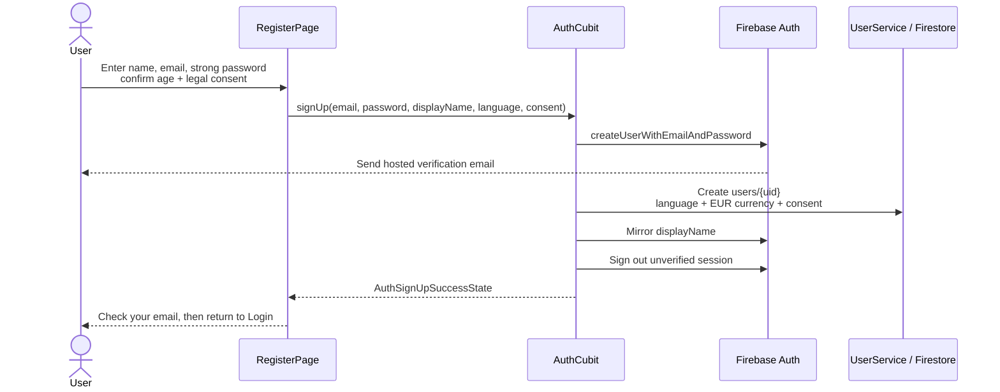
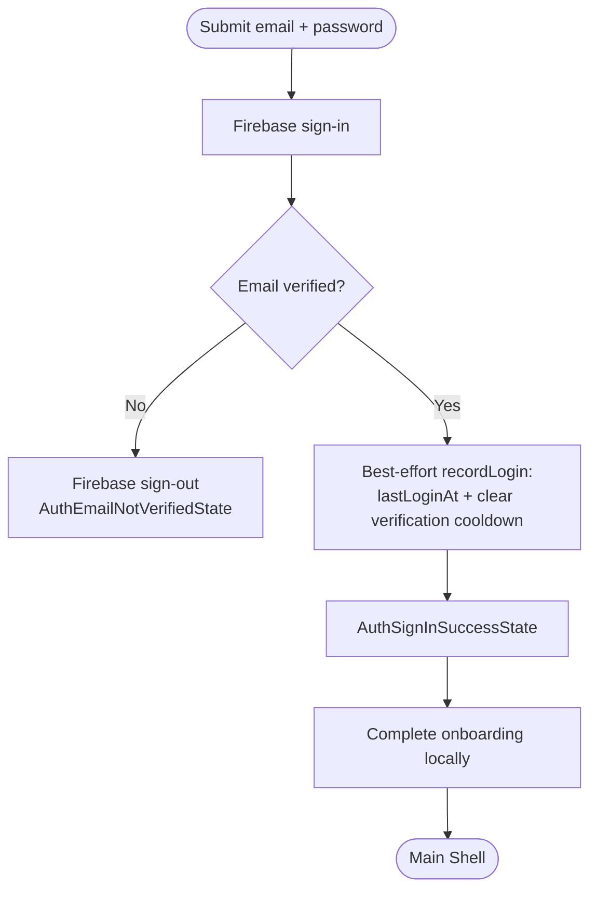
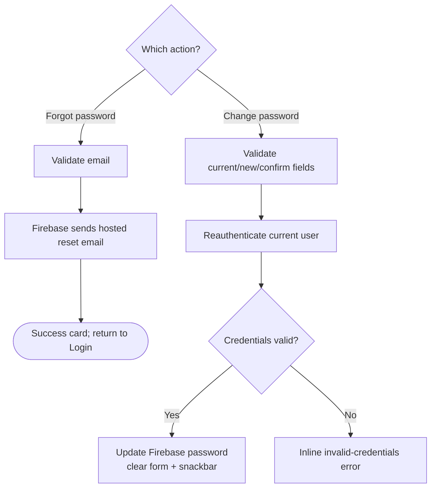
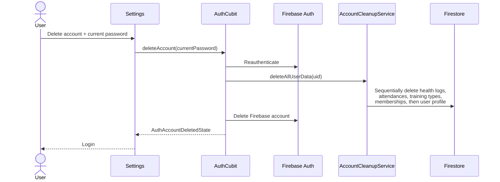

# Authentication & account

> **Status:** ✅ Implemented
> **Last updated:** 2026-07-23

## 1. Summary

Provides email/password registration, mandatory email verification, sign-in, password reset,
password change, runtime auth-state monitoring, sign-out, and permanent account deletion.
Registration also records GDPR consent and creates the Firestore user profile used by account
preferences such as default currency.

## 2. Entry points & navigation

- **Guest routes:** `/login`, `/register`, `/forgot-password`.
- **Authenticated routes:** `/change-password` and account deletion in `/settings`.
- **Successful sign-in:** replaces the current route with `MainShellRoute` and marks onboarding complete.
- **Successful sign-up:** stays on Register and shows a success card; the user must verify via Firebase's hosted email link before signing in.
- **Sign-out / account deletion / runtime unauthenticated event:** routes to `LoginRoute`.
- **Guards:** `AuthGuard` allows only a non-null Firebase user whose `emailVerified` is `true`.

## 3. Key files

| Layer | File |
| ----- | ---- |
| Pages | [login_page.dart](../../lib/presentation/pages/auth/login_page.dart) · [register_page.dart](../../lib/presentation/pages/auth/register_page.dart) · [forgot_password_page.dart](../../lib/presentation/pages/auth/forgot_password_page.dart) · [change_password_page.dart](../../lib/presentation/pages/change_password/change_password_page.dart) |
| Cubit + states | [auth_cubit.dart](../../lib/cubit/auth/auth_cubit.dart) · [auth_states.dart](../../lib/cubit/auth/auth_states.dart) |
| Auth service | [auth_service.dart](../../lib/service/auth/auth_service.dart) · [auth_service_exceptions.dart](../../lib/service/auth/auth_service_exceptions.dart) |
| User profile | [user_service.dart](../../lib/service/user/user_service.dart) · [user_source.dart](../../lib/data/remote/user/user_source.dart) · [user_dto.dart](../../lib/data/remote/user/user_dto.dart) · [user_mapper.dart](../../lib/data/mappers/user_mapper.dart) |
| Account cleanup | [account_cleanup_service.dart](../../lib/service/account/account_cleanup_service.dart) · [account_cleanup_source.dart](../../lib/data/remote/account/account_cleanup_source.dart) |
| Route guard | [auth_guard.dart](../../lib/core/guards/auth_guard.dart) |
| Models | [auth_user.dart](../../lib/model/auth_user.dart) · [user.dart](../../lib/model/user.dart) |
| Consent controls | [legal_consent_checkbox.dart](../../lib/presentation/controls/legal_consent_checkbox.dart) · [labeled_checkbox.dart](../../lib/presentation/controls/labeled_checkbox.dart) |
| Localization keys | prefixes: `auth*`, `errors*`, and password/delete keys under `settings*` |

## 4. Data model & Firestore

Firebase Authentication is the credential and email-verification source of truth. The companion
profile is stored at `users/{uid}`:

| Field | Type | Meaning |
| ----- | ---- | ------- |
| `email` | String | Mirrors Firebase Auth email |
| `displayName` | String | Name entered during registration; also mirrored to Firebase Auth |
| `theme` | String | Initial profile value (`dark`); runtime theme is local in `SharedPreferences` |
| `language` | String | Current app locale at registration (Register has no language selector) |
| `currency` | String | Account default; every new account starts with EUR and can change it in Settings |
| `createdAt` | Timestamp | Server timestamp written at profile creation |
| `lastLoginAt` | Timestamp | Server timestamp refreshed after verified sign-in |
| `lastVerificationEmailSentAt` | Timestamp? | Registration cooldown marker; deleted after verified sign-in |
| `consent` | Map | Terms/privacy versions and URLs, locale, age confirmation, acceptance flags, server `acceptedAt` |
| `totalAttendances` | Number | Legacy/profile aggregate read by `UserDto` |

Profile creation and login updates use `SetOptions(merge: true)`. A missing/unsupported legacy
currency is normalized to EUR by `UserMapper`.

## 5. Cubit states

| State | Emitted when | UI response |
| ----- | ------------ | ----------- |
| `PendingState` | Any guarded auth mutation begins | Disable form / show loading UI |
| `AuthAuthenticatedState` | `watchAuthState()` receives a Firebase user | Profile renders user data |
| `AuthUnauthenticatedState` | Auth stream emits null | Runtime redirect to Login |
| `AuthSignInSuccessState` | Verified sign-in and best-effort login recording succeed | Complete onboarding and enter Main Shell |
| `AuthSignUpSuccessState` | Account/profile setup finishes and Firebase is signed out | Register success card asks user to verify email |
| `AuthPasswordResetSentState` | Firebase accepted reset request | Show reset-email success card |
| `AuthPasswordChangedState` | Reauthentication + password update succeed | Clear form and show success snackbar |
| `AuthSignOutSuccessState` | Sign-out succeeds | Route to Login |
| `AuthAccountDeletedState` | Firestore cleanup and Auth deletion succeed | Route to Login |
| `AuthEmailNotVerifiedState` | Sign-in user has unverified email | Inline verification message; service signs user out |
| `AuthInvalidCredentialsState` | Wrong credentials/current password | Inline error |
| `AuthEmailAlreadyInUseState` / `AuthWeakPasswordState` | Typed Firebase registration failures | Inline registration error |
| `SomethingWentWrongState` | Any unclassified failure | Generic localized error |

## 6. User workflows

### 6.1 Registration and verification

**In plain English:**

1. The page validates display name, email, password strength/match, age 16+, and legal consent.
2. Firebase creates the account and sends its hosted verification email.
3. Profile creation is best-effort. Register has no language selector: it stores the current `LocaleHelper` value as `language`, while account currency always starts as EUR.
4. The display name is mirrored to Firebase Auth, also best-effort.
5. The new Firebase session is explicitly signed out, preventing an unverified account from entering guarded routes after restart.
6. Verification/reset links are completed in Firebase's browser-hosted action page; there is no in-app deep-link handler.

### 6.2 Verified sign-in

**In plain English:**

1. Firebase validates credentials.
2. An unverified account is immediately signed out and stays on Login.
3. A verified account gets a best-effort profile login timestamp update.
4. Login marks onboarding complete in `SharedPreferences` and replaces the route with Main Shell.
5. `AuthGuard` and `SplashCubit` independently require `emailVerified == true` as defense in depth.

### 6.3 Password reset and change

**In plain English:**

1. Forgot Password sends a Firebase reset email and stays on the page until the user returns to Login.
2. Change Password is authenticated and uses `SetPasswordCard` for current/new/confirm validation.
3. Firebase reauthenticates before changing the password; wrong current password maps to `AuthInvalidCredentialsState`.

### 6.4 Permanent account deletion

**In plain English:**

1. Settings asks for the current password and reauthenticates first.
2. User-owned Firestore data is deleted before Firebase Auth, because Firestore rules require authentication.
3. Nested collections are removed sequentially and in batches of at most 500; retrying after partial failure is safe.
4. Global supplement products created by the user are intentionally retained because other users may reference them.
5. The Firebase Auth account is deleted only after cleanup succeeds.

## 7. Business rules & edge cases

- Every auth mutation uses `guardedAction()`; rapid duplicate submissions are ignored while pending.
- Registration requires password length ≥ 8 plus uppercase, lowercase, and number, even though Firebase may enforce different minimums.
- Profile creation, display-name mirroring, Crashlytics user-ID sync, and login recording are best-effort; credential flow must remain usable if profile telemetry fails.
- `AuthService` maps Firebase error codes to typed domain exceptions; unknown Firebase errors become `SomethingWentWrongState`.
- `AuthGuard` and the cold-launch gate allow only verified Firebase users.
- Firestore cleanup does not remove global `supplementProducts` or local `SharedPreferences` values.
- Account deletion is not transactional across Firestore and Firebase Auth; a cleanup failure leaves Auth intact for safe retry.

## 8. Tests

| Test file | Covers |
| --------- | ------ |
| [auth_cubit_test.dart](../../test/cubit/auth/auth_cubit_test.dart) | state mapping, unconditional EUR signup default, sign-out after registration, login recording, password flows, ordered account deletion |
| [auth_service_test.dart](../../test/service/auth/auth_service_test.dart) | Firebase delegation, verification sign-out, typed error mapping, password/auth operations |
| [auth_guard_test.dart](../../test/core/guards/auth_guard_test.dart) | verified allow; unverified/null redirect |
| [register_page_test.dart](../../test/presentation/pages/auth/register_page_test.dart) | validation, legal/age consent, language forwarding, loading/error/success UI |
| [forgot_password_page_test.dart](../../test/presentation/pages/auth/forgot_password_page_test.dart) | reset form and success flow |
| [change_password_page_test.dart](../../test/presentation/pages/change_password/change_password_page_test.dart) | password-change UI and feedback |

**Coverage gaps:** Login page widget behavior, Firestore profile source writes, account-cleanup batching/order against a fake Firestore, and Firebase hosted email-action pages.

## 9. Known limitations & improvement candidates

- No resend-verification-email UI, despite storing a cooldown timestamp.
- No in-app Firebase action-code/deep-link handling; verification and reset rely on the hosted browser page.
- Profile synchronization is best-effort, so a rare Firestore outage during registration can create an Auth account without a profile document; legacy fallbacks cover currency but not full profile repair.
- Account deletion retains globally shared products and device-local preferences by design; a future ownership/anonymization policy could make that behavior more explicit.
