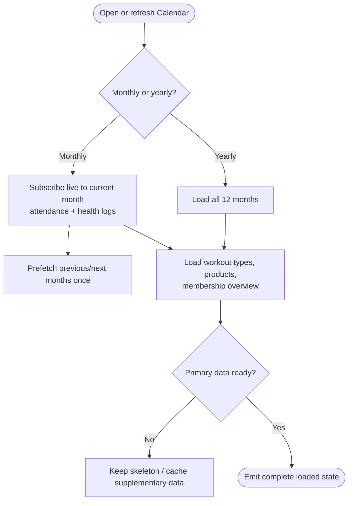
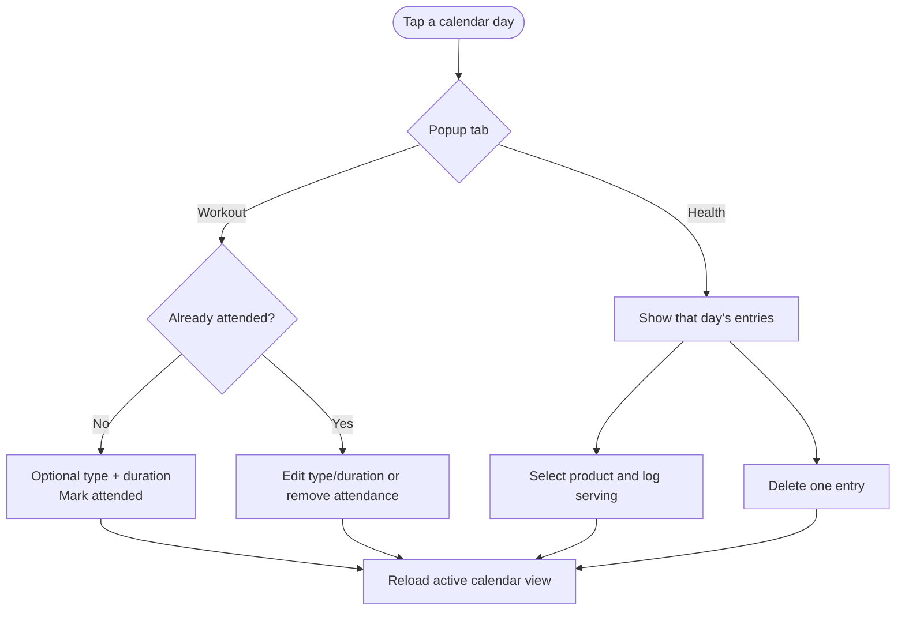
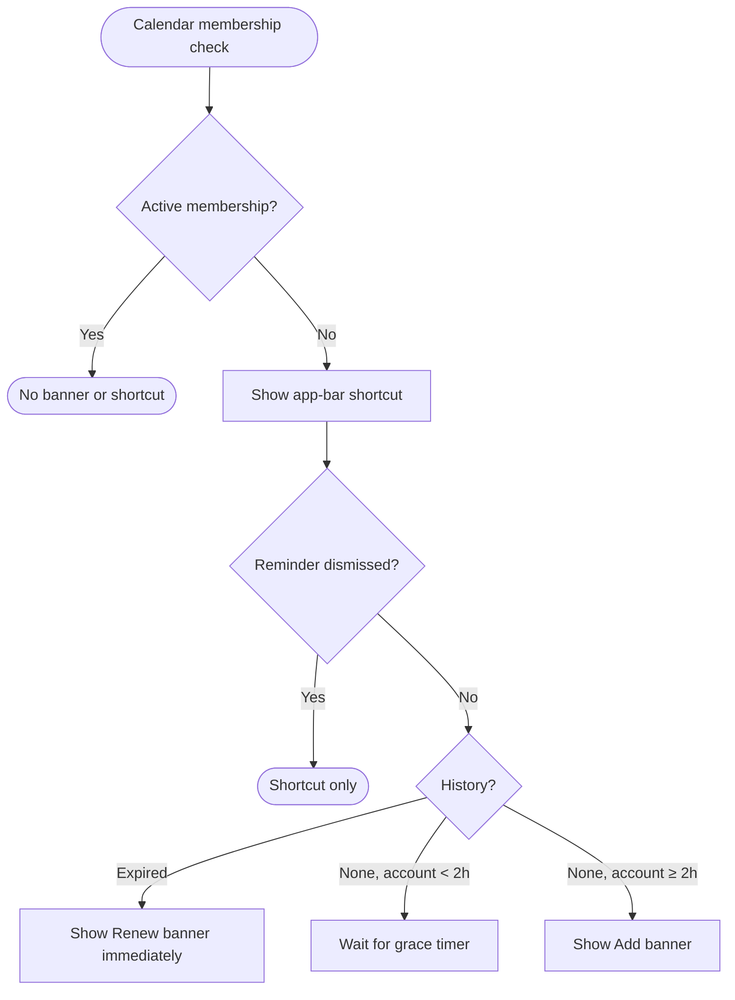

# Calendar — attendance, supplements & membership reminder

> **Status:** ✅ Implemented
> **Last updated:** 2026-07-22

## 1. Summary

The home tab. Shows a monthly or yearly grid of gym attendance and supplement logs, lets
the user mark/edit attendance and log supplements per day, and surfaces a gym-membership
reminder when no active membership exists.

## 2. Entry points & navigation

- **In:** MainShell tab 0 (initial tab).
- **Out:** day-tap opens an in-page modal; the membership banner/app-bar shortcut push `MembershipHistoryRoute`.

## 3. Key files

| Layer | File |
| ----- | ---- |
| Page | [calendar_page.dart](../../lib/presentation/pages/calendar/calendar_page.dart) |
| Membership banner | [membership_reminder_banner.dart](../../lib/presentation/pages/calendar/widgets/membership_reminder_banner.dart) |
| Cubit + states | [calendar_cubit.dart](../../lib/cubit/calendar/calendar_cubit.dart) · [calendar_states.dart](../../lib/cubit/calendar/calendar_states.dart) |
| Services | [attendance_service.dart](../../lib/service/attendance/attendance_service.dart) · [health_service.dart](../../lib/service/health/health_service.dart) · [workout_service.dart](../../lib/service/workout/workout_service.dart) · [gym_membership_service.dart](../../lib/service/membership/gym_membership_service.dart) · [membership_reminder_service.dart](../../lib/service/membership/membership_reminder_service.dart) |
| Controls | [gym_tab_bar.dart](../../lib/presentation/controls/gym_tab_bar.dart) · [pull_to_refresh.dart](../../lib/presentation/controls/pull_to_refresh.dart) |
| Localization keys | prefix: `calendar*`, plus `membership*` for the banner |

## 4. Data model & Firestore

Reads attendance and health logs (see [health_supplements.md](health_supplements.md) and the
`attendances` collection). Calendar **never writes membership data**; membership is read-only here.

- Attendance: `users/{uid}/attendances/{YYYY-MM}/days/{YYYY-MM-DD}`
- Health logs: `users/{uid}/healthLogs/{YYYY-MM}/entries/{logId}`

## 5. Cubit states

| State | Emitted when | UI response |
| ----- | ------------ | ----------- |
| `PendingState` | initial load | skeleton |
| `CalendarMonthLoadedState` | monthly data ready | render month grid (+ membership fields) |
| `CalendarYearLoadedState` | yearly data ready | render year grid (+ membership fields) |
| `CalendarDayMarkedState` / `CalendarDayClearedState` | attendance mutation | reload active view |
| `CalendarSupplementLoggedState` / `CalendarSupplementDeletedState` | supplement mutation | reload active view |
| `SomethingWentWrongState` | mutation error | snackbar |

Both loaded states also carry: `membership`, `membershipChecked`, `membershipReminderEligible`, `membershipReminderDismissed`.

## 6. User workflows

### 6.1 Load & listener strategy

**In plain English:**

1. The **current** month opens live Firestore listeners for attendance + supplement logs (real-time writes).
2. **Prev/next** months are fetched once in the background with `get()` (no live listener).
3. `_monthReady` / `_yearReady` gates stop supplementary callbacks (products, types, membership) from emitting a half-loaded state.
4. A current-month stream error **degrades to empty data**, not a full error page.

### 6.2 Day popup (attendance + supplements)

**In plain English:**

1. Tap a day → modal with **Workout** and **Health** tabs.
2. Workout tab: mark/unmark attendance, pick optional workout type + duration, edit later.
3. Health tab: view that day's supplement logs (2-per-page carousel), add a log from a product dropdown, remove a log.
4. Each mutation goes through `CalendarCubit` and reloads the active view.

### 6.3 Membership reminder

See the full decision diagram and rules in
[gym_membership.md §6.4](gym_membership.md#64-calendar-reminder--when-does-it-appear).
Short version: banner shows for expired history (immediately) or missing history (after a
2-hour new-account grace), unless permanently dismissed; an app-bar shortcut shows whenever
no membership is active.

**In plain English:**

1. An active membership hides every membership prompt.
2. Without an active membership, the app-bar shortcut remains available even during grace or after dismissal.
3. Expired history is reminder-eligible immediately; no-history accounts wait two hours after account creation.
4. Dismissing the banner persists per user on this device and does not hide the shortcut.

## 7. Business rules & edge cases

- Monthly grid = 7-col Mon-first, 42 cells; today highlighted.
- Yearly grid = 12 mini-months.
- Day colors: workout=`calWorkout`, supplement=`calSupplement`, both=`calBoth`.
- `PullToRefresh` wraps the `TabBarView` with `notificationPredicate: verticalScrollNotification` so horizontal tab swipes still work; refresh reloads the active view **and** the membership overview.
- Membership lookup failure is non-fatal (`membershipChecked = false`).

## 8. Tests

| Test file | Covers |
| --------- | ------ |
| [calendar_cubit_test.dart](../../test/cubit/calendar/calendar_cubit_test.dart) | month/year load, error degrade, membership overview + grace + dismissal |
| [membership_reminder_banner_test.dart](../../test/presentation/pages/calendar/membership_reminder_banner_test.dart) | banner copy variants |

## 9. Known limitations & improvement candidates

- Active-membership → expired transition is not scheduled by a timer; it appears on the next rebuild/refresh/route-return.
- Concurrent `loadMembershipOverview` calls have no request token (a slow earlier call could overwrite a newer one).
- Yearly view loads the full year up-front (no incremental month streaming).
