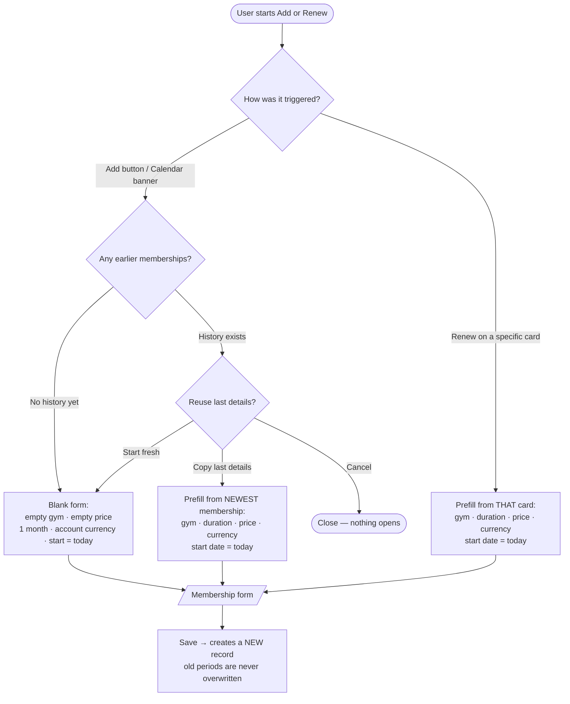
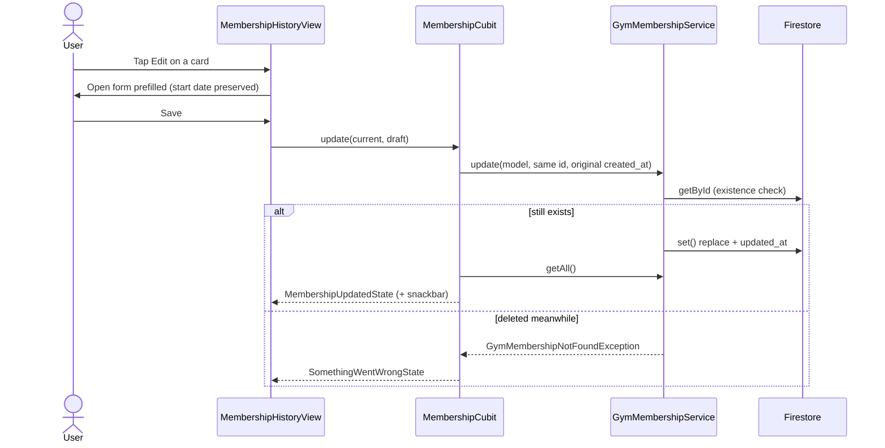
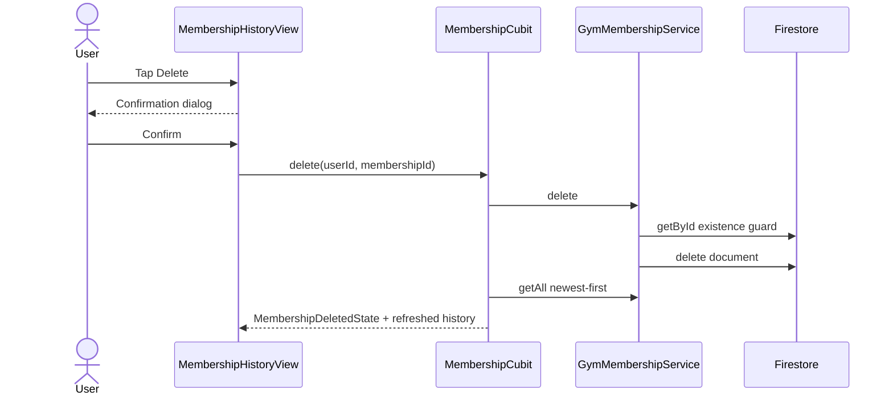
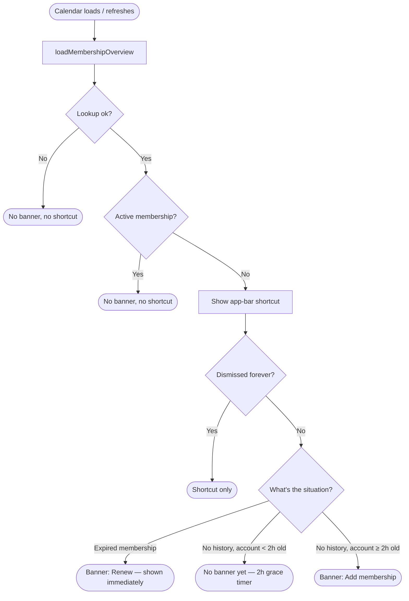
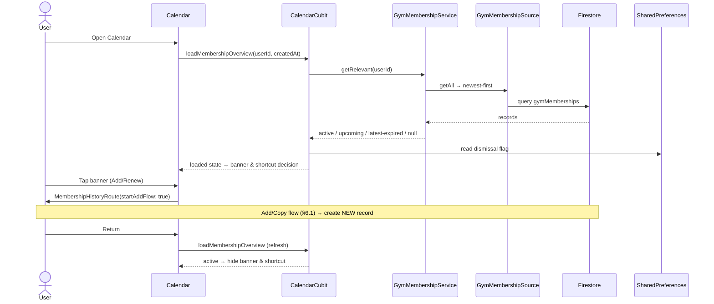

# Gym Membership — manual purchase history

> **Status:** ✅ Implemented
> **Last updated:** 2026-07-23

## 1. Summary

Lets the user keep a **manual history of paid gym-membership periods** (gym name, start
date, validity, price, currency). The app never processes payments, infers purchases,
cancels, or auto-renews — every record is an explicit historical entry. The Calendar
surfaces a reminder when no active membership exists.

## 2. Entry points & navigation

- **In:**
  - Profile → "Membership history" row → `MembershipHistoryRoute()`.
  - Calendar reminder banner → `MembershipHistoryRoute(startAddFlow: true)` (opens the add flow immediately).
  - Calendar app-bar shortcut (shown whenever no membership is active) → `MembershipHistoryRoute()`.
- **Out:** back to the previous route. After returning to Calendar, Calendar re-runs its membership overview.
- **Guard:** `/membership-history` is behind `AuthGuard`.

## 3. Key files

| Layer | File |
| ----- | ---- |
| Page | [membership_history_page.dart](../../lib/presentation/pages/membership_history/membership_history_page.dart) |
| Card widget | [membership_history_card.dart](../../lib/presentation/pages/membership_history/widgets/membership_history_card.dart) |
| Form control | [membership_form_sheet.dart](../../lib/presentation/controls/membership_form_sheet.dart) |
| Calendar banner | [membership_reminder_banner.dart](../../lib/presentation/pages/calendar/widgets/membership_reminder_banner.dart) |
| Cubit + states | [membership_cubit.dart](../../lib/cubit/membership/membership_cubit.dart) · [membership_states.dart](../../lib/cubit/membership/membership_states.dart) |
| Service | [gym_membership_service.dart](../../lib/service/membership/gym_membership_service.dart) · [exceptions](../../lib/service/membership/gym_membership_service_exceptions.dart) |
| Reminder service | [membership_reminder_service.dart](../../lib/service/membership/membership_reminder_service.dart) |
| Source | [gym_membership_source.dart](../../lib/data/remote/membership/gym_membership_source.dart) |
| DTO + mapper | [gym_membership_dto.dart](../../lib/data/remote/membership/gym_membership_dto.dart) · [gym_membership_mapper.dart](../../lib/data/mappers/gym_membership_mapper.dart) |
| Model | [gym_membership.dart](../../lib/model/gym_membership.dart) |
| Money helper | [currency_formatter.dart](../../lib/core/utils/currency_formatter.dart) |
| Calendar integration | [calendar_cubit.dart](../../lib/cubit/calendar/calendar_cubit.dart) · [calendar_page.dart](../../lib/presentation/pages/calendar/calendar_page.dart) |
| Account cleanup | [account_cleanup_source.dart](../../lib/data/remote/account/account_cleanup_source.dart) |
| Localization keys | prefix: `membership*`, `profileMembershipHistory*` |

## 4. Data model & Firestore

**Path:** `users/{uid}/gymMemberships/{membershipId}`

| Field | Type | Meaning |
| ----- | ---- | ------- |
| `gym_name` | String | Gym / club name |
| `start_date` | `YYYY-MM-DD` String | Purchase / start date (timezone-safe) |
| `duration_months` | Number | 1, 3, 6, or 12 |
| `valid_until` | `YYYY-MM-DD` String | Inclusive end date, snapshotted at save time |
| `price_minor` | Number | Integer minor units (e.g. 15000 = 150.00) |
| `currency` | String | EUR, GBP, RON, or USD |
| `created_at` | Timestamp | Server timestamp (set once) |
| `updated_at` | Timestamp | Server timestamp (set on every write) |

**Invariants**

- Status (upcoming / active / expired) is **derived**, never stored — see [gym_membership.dart](../../lib/model/gym_membership.dart).
- `start_date` and `valid_until` are both **inclusive** and date-only.
- Validity uses **calendar-month** math and clamps invalid target days (Jan 31 + 1 month → Feb 28/29).
- Price is always integer minor units; parsing never uses floating point ([currency_formatter.dart](../../lib/core/utils/currency_formatter.dart)).
- Renewal always creates a **new** document; no record is ever rewritten by renew.
- `getAll` orders by `start_date` **descending** (newest first), so "latest" = `memberships.first`.

## 5. Cubit states

`MembershipCubit` (all subclasses of `MembershipsReadyState` carry the refreshed `memberships` list):

| State | Emitted when | UI response |
| ----- | ------------ | ----------- |
| `PendingState` | any load or guarded mutation starts | skeleton / in-flight |
| `MembershipsLoadedState` | history loaded | render list / empty state |
| `MembershipCreatedState` | create succeeded | success snackbar + refreshed list |
| `MembershipUpdatedState` | edit succeeded | success snackbar + refreshed list |
| `MembershipDeletedState` | delete succeeded | success snackbar + refreshed list |
| `SomethingWentWrongState` | any failure | error state / retry |

Calendar carries membership context inside its own loaded states
([calendar_states.dart](../../lib/cubit/calendar/calendar_states.dart)): `membership`,
`membershipChecked`, `membershipReminderEligible`, `membershipReminderDismissed`.

## 6. User workflows

### 6.1 Add / Renew / Copy

**In plain English:**

1. **Renew on a card** skips the question and copies *that* card; start date resets to today.
2. **Add button** or the **Calendar "Add/Renew" banner**:
    - No history yet → blank form (1 month, the account's default currency, today).
   - History exists → ask **Copy last details / Start fresh / Cancel**.
     - *Copy last details* → copies the **newest** membership; start date resets to today.
     - *Start fresh* → blank form.
3. Saving always **creates a new document**. The old expired period stays untouched.

> Every account starts with EUR and can change its default in Settings. Changing the
> default later affects only new blank drafts; copied and historical records
> retain their own stored currency.

### 6.2 Edit

**In plain English:**

1. Edit opens the form with the existing values; the original start date is kept.
2. Save keeps the same document ID and `created_at`, recomputes `valid_until`, and replaces the doc.
3. The service checks the record still exists first; if it was deleted elsewhere, you get an error state.

### 6.3 Delete

**In plain English:**

1. Tap **Delete** → destructive confirmation dialog.
2. Confirm → service verifies the doc exists → Firestore delete → history reloads → success snackbar.
3. Only that one record is removed.

### 6.4 Calendar reminder — when does it appear?

**In plain English:**

1. On every Calendar load/refresh, `CalendarCubit.loadMembershipOverview` fetches the relevant membership and the per-user dismissal flag.
2. If the lookup **fails**, Calendar shows nothing membership-related and keeps working.
3. If a membership is **active**, no banner and no shortcut.
4. Otherwise the **app-bar shortcut** appears (even during grace or after dismissal).
5. The **banner** appears when *not dismissed* and either:
   - the relevant membership is **expired** (immediately), or
   - there's **no history** and the account is **at least 2 hours old** (new accounts get a 2-hour grace period; a timer re-checks when it elapses).
6. Tapping the banner's **X** dismisses it **forever for that user on this device** (stored in `SharedPreferences`).

### 6.5 End-to-end

**In plain English:**

1. Calendar reads the relevant membership and local dismissal flag without writing membership data.
2. Add/Renew opens Membership History with `startAddFlow: true`, where the blank/copy workflow creates a new record.
3. Returning to Calendar triggers another overview load.
4. A newly active period hides both the reminder banner and app-bar shortcut.

## 7. Business rules & edge cases

- **Relevant selection** ([getRelevant](../../lib/service/membership/gym_membership_service.dart)): active → nearest upcoming → most-recently-expired → null.
- **Validity math, inclusive:** "1 month" adds exactly 30 date-only days; 3/6/12 months use calendar-month arithmetic with end-of-month clamping. `validUntil` is active through that date.
- **Guarded writes:** create/update/delete use `guardedAction()` — rapid double-taps cannot create duplicates.
- **Existence guards:** update/delete throw `GymMembershipNotFoundException` if the record vanished; the cubit maps it to `SomethingWentWrongState`.
- **Failure never blocks Calendar:** a membership lookup error sets `membershipChecked = false`, so neither banner nor shortcut renders, and Calendar proceeds normally.
- **Grace period clamp:** a future/ skewed `creationTime` is capped so the delay never exceeds 2 hours; a missing timestamp = immediately eligible.
- **Dismissal is local:** stored as `membership_reminder_dismissed_<uid>` in `SharedPreferences`; lost on reinstall / cleared data / another device, and **not** cleared on account deletion.
- **Account deletion** removes `users/{uid}/gymMemberships/*` before the profile doc ([account_cleanup_source.dart](../../lib/data/remote/account/account_cleanup_source.dart)).
- **Reads are one-shot** (not live). Cross-device changes appear after refresh / route re-entry.
- **`update` uses `set()` (replace), not merge** — unknown extra fields on a doc would be dropped.

## 8. Tests

| Test file | Covers |
| --------- | ------ |
| [gym_membership_test.dart](../../test/model/gym_membership_test.dart) | calendar-month math, inclusive status, copy draft |
| [currency_formatter_test.dart](../../test/core/utils/currency_formatter_test.dart) | parse/format, comma/dot, rejection |
| [gym_membership_dto_test.dart](../../test/data/remote/membership/gym_membership_dto_test.dart) | DTO serialization, id exclusion |
| [gym_membership_service_test.dart](../../test/service/membership/gym_membership_service_test.dart) | relevant selection, update existence guard |
| [membership_reminder_service_test.dart](../../test/service/membership/membership_reminder_service_test.dart) | 2h grace, clamp, per-user dismissal |
| [membership_cubit_test.dart](../../test/cubit/membership/membership_cubit_test.dart) | load / create / error |
| [membership_form_sheet_test.dart](../../test/presentation/controls/membership_form_sheet_test.dart) | prefilled draft return |
| [membership_reminder_banner_test.dart](../../test/presentation/pages/calendar/membership_reminder_banner_test.dart) | missing vs expired copy |
| [membership_history_page_test.dart](../../test/presentation/pages/membership_history/membership_history_page_test.dart) | copy-last, empty state, direct add |
| [calendar_cubit_test.dart](../../test/cubit/calendar/calendar_cubit_test.dart) | overview, grace, dismissal |

**Coverage gaps:** Firestore source + mapper, successful cubit update/delete, full edit/renew/delete widget flows, real timer expiry, account-cleanup membership deletion.

## 9. Known limitations & improvement candidates

- **Dismissal is device-local**, not synced and not cleared on account deletion.
- **No Firestore-rule validation** of field types / allowed currency / duration / positive price.
- **One-shot reads** — no live sync across devices.
- **Renew from the Calendar banner** doesn't pre-target the expired record; it re-asks Copy/Start-fresh. Only *Renew on a card* copies directly.
