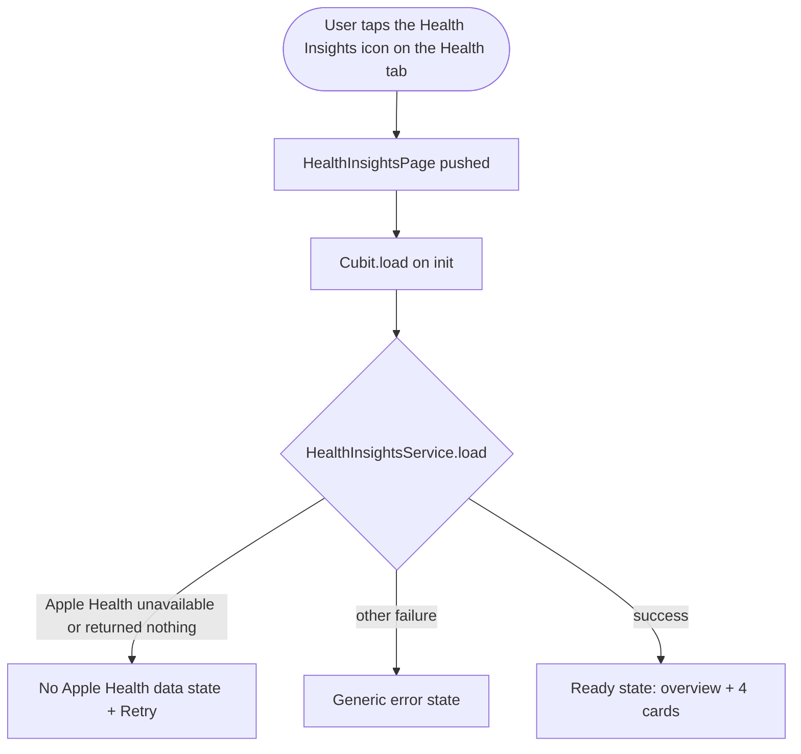
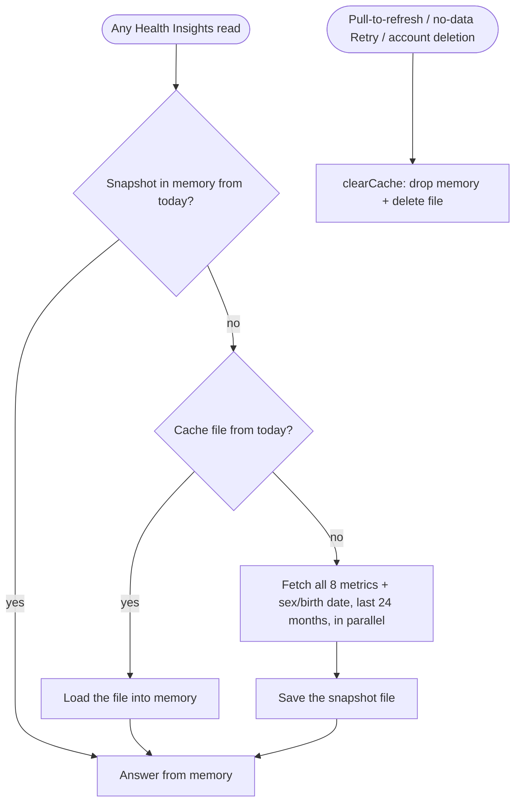
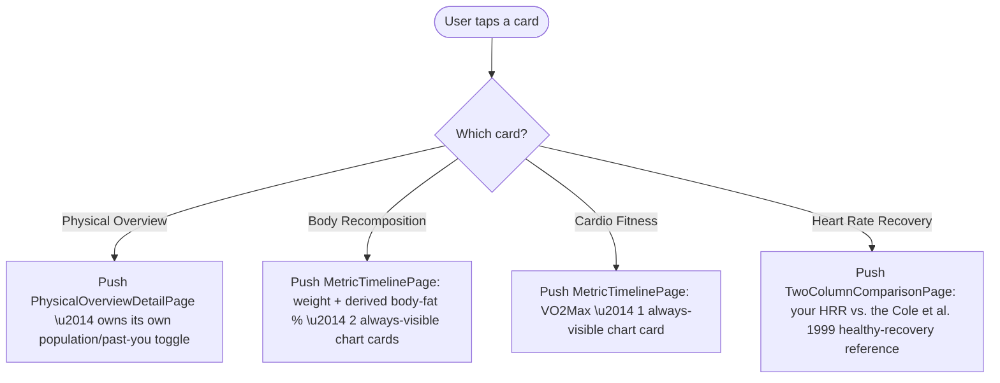

# Health Insights

> **Status:** ✅ Implemented (v4 — live Apple Health, iOS-only)
> **Last updated:** 2026-10-12 (Android shows none of the feature; anonymized test fixtures; student guide added)
>
> **New to HealthKit?** Read [`docs/guides/apple_health_data_flow.md`](../guides/apple_health_data_flow.md) —
> a step-by-step, code-level walk-through of how the data gets from the iPhone to the screen.

## 1. Summary

Apple Watch / Apple Health analytics the stock Health app doesn't surface: a Physical
Overview snapshot (weight / age / height, plus body fat % and a stress index when
there's a scale reading from the last 3 months), body recomposition, weight-adjusted
VO2Max, Heart Rate Recovery (HRR), and personalized resting-energy +
TDEE estimates. Every history-backed card opens a monthly chart detail page; HRR
instead opens a simple "you vs. a reference value" comparison. The
Physical Overview card opens its own dedicated detail page with a population/past-you
toggle. Data comes live from Apple Health through the app's own HealthKit bridge, bounded
to the last 24 months and read at most once per day — the rest of the day is served from
an on-device cache, so the page loads fast and every chart stays readable.

## 2. Entry points & navigation

- **In:** an iOS-only icon action (`Platform.isIOS` gated) on the Health (Supplements)
  tab's app bar → pushes `/health-insights`.
- **Within the page:**
  - Body Recomposition / Cardio Fitness cards → push `/health-insights/timeline`
    (`MetricTimelinePage`, shared/generic monthly chart page).
  - The Heart Rate Recovery card → pushes `/health-insights/compare`
    (`TwoColumnComparisonPage`, shared/generic "you vs. reference" page).
  - The Physical Overview card (the whole card, not a sub-row) → pushes
    `/health-insights/overview` (`PhysicalOverviewDetailPage`), which owns its own
    population/past-you toggle.
- **Out:** each page's own back button (via `GymAppBar`) returns to its caller.

## 3. Key files

| Layer | File |
| ----- | ---- |
| Pages | [health_insights_page.dart](../../lib/presentation/pages/health_insights/health_insights_page.dart), [metric_timeline_page.dart](../../lib/presentation/pages/health_insights/metric_timeline_page.dart), [two_column_comparison_page.dart](../../lib/presentation/pages/health_insights/two_column_comparison_page.dart), [physical_overview_detail_page.dart](../../lib/presentation/pages/health_insights/physical_overview_detail_page.dart) |
| Widgets | [widgets/](../../lib/presentation/pages/health_insights/widgets/) — `insight_card_frame.dart` (supports an optional `onTap` + chevron), `insight_info_button.dart`, `insight_stat_row.dart`, `benchmark_row.dart`, `trend_sparkline.dart` (line chart with OX month labels + OY max-value label), `monthly_bar_chart.dart` (stats-page-style vertical bars: value above, short month name below, zoomed baseline), `series_chart_card.dart` (always-visible chart card: title/period/value/change + `MonthlyBarChart`), `comparison_rows_card.dart` (you-vs-reference rows), `physical_overview_card.dart`, `body_recomposition_card.dart`, `cardio_fitness_card.dart`, `heart_rate_recovery_card.dart`, `metabolic_card.dart` |
| Cubits + states | [health_insights_cubit.dart](../../lib/cubit/health_insights/health_insights_cubit.dart) + states, [metric_timeline_cubit.dart](../../lib/cubit/health_insights/metric_timeline_cubit.dart) + states (generic, shared by Body Recomposition + Cardio Fitness), [physical_overview_detail_cubit.dart](../../lib/cubit/health_insights/physical_overview_detail_cubit.dart) + states |
| Service | [health_insights_service.dart](../../lib/service/health_insights/health_insights_service.dart) (orchestrator) + [population_norms.dart](../../lib/service/health_insights/population_norms.dart), [body_composition_analyzer.dart](../../lib/service/health_insights/body_composition_analyzer.dart), [cardio_fitness_analyzer.dart](../../lib/service/health_insights/cardio_fitness_analyzer.dart), [heart_rate_recovery_analyzer.dart](../../lib/service/health_insights/heart_rate_recovery_analyzer.dart), [stress_index_analyzer.dart](../../lib/service/health_insights/stress_index_analyzer.dart), [metric_timeline_builder.dart](../../lib/service/health_insights/metric_timeline_builder.dart) (also owns `reportingWindowStart()`, the rolling 24-month cap), [population_comparison_analyzer.dart](../../lib/service/health_insights/population_comparison_analyzer.dart), [metabolic_analyzer.dart](../../lib/service/health_insights/metabolic_analyzer.dart) |
| Data | [health_repository.dart](../../lib/data/health_insights/health_repository.dart) (interface), [apple_health_repository.dart](../../lib/data/health_insights/apple_health_repository.dart) (bound implementation — daily snapshot cache), [healthkit_source.dart](../../lib/data/health_insights/healthkit_source.dart) (method channel to the iOS bridge), [health_cache_store.dart](../../lib/data/health_insights/health_cache_store.dart) + [health_snapshot.dart](../../lib/data/health_insights/health_snapshot.dart) (cache file + format) |
| Native (iOS) | [HealthKitBridge.swift](../../ios/Runner/HealthKitBridge.swift) (registered in [AppDelegate.swift](../../ios/Runner/AppDelegate.swift)), [Runner.entitlements](../../ios/Runner/Runner.entitlements) (HealthKit capability), `NSHealthShareUsageDescription` in [Info.plist](../../ios/Runner/Info.plist) + `en.lproj` / `ro.lproj` `InfoPlist.strings` |
| Model(s) | [lib/model/health_insights/](../../lib/model/health_insights/) — `health_metric.dart`, `health_sample.dart`, `health_characteristics.dart`, `comparison_mode.dart`, `health_insights_result.dart`, `physical_overview.dart`, `body_composition_trend.dart`, `cardio_fitness.dart`, `heart_rate_recovery.dart`, `stress_index.dart`, `metabolic_estimate.dart`, `population_benchmark.dart`, `population_physical_comparison.dart`, `metric_timeline.dart`, `metric_timeline_spec.dart`, `timeline_range.dart`, `comparison_row_data.dart`; plus [sex.dart](../../lib/model/sex.dart) and [body_type.dart](../../lib/model/body_type.dart) (shared with registration) |
| Test fixtures | [test/fixtures/health_insights/](../../test/fixtures/health_insights/) — one JSON file per metric the feature reads (`body_mass`, `lean_body_mass`, `height`, `vo2_max`, `heart_rate_variability_sdnn`, `heart_rate_recovery`, `basal_energy_daily`, `active_energy_daily`) + `characteristics.json`. **Anonymized**: generic device names and a placeholder birth date (2000-01-01). Generated by [tools/extract_health_fixtures.mjs](../../tools/extract_health_fixtures.mjs) from a sample (gitignored) Apple Health export and read by the test-only [mock_health_repository.dart](../../test/data/health_insights/mock_health_repository.dart). Never bundled into the app. |
| Localization keys | prefix: `healthInsights*` |

## 4. Data model & Firestore

This feature does **not** write to Firestore. It reads:

- `users/{uid}.sex` / `.birthDate` / `.heightCm` / `.weightKg` — optional self-reported
  fields captured at registration (see [auth.md](auth.md)), used as the primary profile
  source and as a fallback for weight/height when no Apple Health sample exists.
- Apple Health data via `HealthRepository` → `AppleHealthRepository` → `HealthKitSource` →
  the iOS `HealthKitBridge` (read-only). Every fetch (except height, see §7) is bounded to
  `MetricTimelineBuilder.reportingWindowStart()` — the last 24 months (e.g. on
  2026-10-09, that's 2024-10-09 → now).
- **Daily on-device cache:** the first read of a calendar day fetches all 8 metrics plus
  sex / birth date in parallel and saves them as one `HealthSnapshot` JSON file
  (`health_insights_cache.json`) in the OS cache directory (`Library/Caches` on iOS — never
  backed up to iCloud, may be purged by iOS). Every later read that day (other pages, app
  restarts) is served from it. Health data never leaves the device and is never written to
  Firestore or any backend.

## 5. Cubit states

| Cubit | States |
| ----- | ------ |
| `HealthInsightsCubit` | `PendingState` → `HealthInsightsReadyState` (overview + 4 cards) / `HealthInsightsPermissionDeniedState` (shown as "No Apple Health data": Apple Health is unavailable or returned nothing at all) / `SomethingWentWrongState`. `load()` uses today's cached snapshot; `refresh()` (pull-to-refresh, no-data Retry) clears it first. Always compares against population norms over a 1-year window — no page-level toggle anymore (see §7). |
| `MetricTimelineCubit` | `PendingState` → `MetricTimelineReadyState` (one `MetricSeriesData` per requested spec, plus a derived body-fat % series when `derivedBodyFatLabel` is passed) / `SomethingWentWrongState`. |
| `PhysicalOverviewDetailCubit` | `PendingState` → `PhysicalOverviewDetailReadyState` (nullable population comparison + weight/lean-mass monthly points) / `SomethingWentWrongState`. |

## 6. User workflows

### Opening Health Insights

**In plain English:**

1. On iOS, the Health tab's insights icon opens Health Insights directly.
2. The cubit loads every card through `HealthInsightsService`, which reads Apple Health
   through the daily cache (next workflow).
3. If Apple Health is unavailable or returns nothing at all, the page explains how to
   allow access; its Retry re-reads Apple Health. Any other failure shows the generic
   error state.

### Reading Apple Health (daily cache)

**In plain English:**

1. Every read goes through `AppleHealthRepository`. If it already holds a snapshot
   fetched today, the read is answered from memory.
2. Otherwise it loads `health_insights_cache.json`; a file written today is reused (for
   example after an app restart).
3. With no snapshot from today, it fetches every metric for the last 24 months in
   parallel (energy as HealthKit daily totals, height as the latest reading ever) plus sex
   and birth date, saves the snapshot, and answers from it. Reads that arrive meanwhile
   share that single fetch.
4. Pull-to-refresh and the no-data Retry clear the cache first, so they always re-read
   Apple Health. A load that finds no Apple Health data at all also clears it, so granting
   access later shows data on the next open. Deleting the account deletes the file.

### Drilling into a card

**In plain English:**

1. Every tappable card shows a trailing chevron (`InsightCardFrame`'s optional `onTap`).
   A card with no data at all (e.g. no VO2Max readings) is not tappable.
2. Body Recomposition and Cardio Fitness open the shared `MetricTimelinePage`: range
   chips (filtered to what the \u2014 now capped \u2014 history actually supports) plus one
   always-visible chart card per series, styled like the Stats page's bar charts (value
   labeled above each bar, month below).
3. Heart Rate Recovery opens the shared `TwoColumnComparisonPage`: just a "you" column
   and a reference column, no chart \u2014 HRR uses a clinical reference (Cole et al. 1999),
   not a population average.
4. The Physical Overview card opens `PhysicalOverviewDetailPage`, which has its own
   population/past-you toggle (population mode: a comparison card; past-you mode: range
   chips + weight/lean-mass charts) \u2014 this toggle no longer exists on the main page.

## 7. Business rules & edge cases

- **iOS-only — Android shows nothing of this feature.** The Health tab's insights icon is
  gated behind `Platform.isIOS`, and the optional personal-details step at sign-up
  (sex, birth date, height, weight, body type — which only feeds this feature) is shown only
  on iOS; on Android "Create Account" signs up straight from the credentials step with
  every personal-detail field `null`. The route itself has no platform guard, so it must
  not be linked from anywhere reachable on Android (if it were reached,
  `HealthKitSource.requestAuthorization` returns `false` off iOS and the page shows the
  "No Apple Health data" state).
- **Every fetch is bounded to the last 24 months**
  (`MetricTimelineBuilder.reportingWindowStart()`, from local midnight two years ago),
  **except height** \u2014 a lifetime-stable trait rarely re-logged, so only the latest
  reading ever is read (the bridge's `latestSample`). This keeps every load fast and every
  chart's x-axis meaningfully short, at the cost of older history \u2014 an explicit,
  deliberate trade-off.
- **Apple Health is read at most once per calendar day** (see "Reading Apple Health" in
  §6); pull-to-refresh is how a reading added later the same day shows up.
- **Energy (basal/active) is read as HealthKit daily totals** (`HKStatisticsCollectionQuery`
  cumulative sum per local day), which also merges overlapping iPhone + Watch samples; the
  metabolic analyzer expects one value per day.
- **"No Apple Health data":** iOS never reveals whether read access was denied (denied
  types just return nothing). When Apple Health is unavailable or every metric and both
  characteristics come back empty, the page shows a dedicated state explaining how to
  allow access (Health app › profile › Apps › Gym Tracker), and the empty snapshot is not
  kept.
- **Heart Rate Recovery needs iOS 16+** (`HKQuantityTypeIdentifierHeartRateRecoveryOneMinute`);
  on older iOS versions the card shows "not enough data".
- **Profile resolution order:** `sex`/`birthDate` prefer the app's own `User` profile over
  Apple Health characteristics; `heightCm`/current weight prefer a live Apple Health
  sample over the self-reported profile value.
- **Per-card graceful degradation:** each of the four result fields on
  `HealthInsightsResult` is independently nullable. A card with insufficient data renders
  its own "not enough data" message and is not tappable, rather than the whole page
  failing or the card disappearing.
- **Physical Overview row 2 (body fat % + stress index) only renders when there's a
  recent scale reading**: the latest lean-body-mass sample must be within the last 90
  days.
- **Stress index** is a 0\u2013100 estimate from how far today's HRV sits below the user's own
  rolling 60-day baseline; self-baselined only, never compared to other people.
- **Population comparisons are age/sex/height-adjusted, not a flat reference.**
  `PopulationNorms` holds an average-BMI-by-age-decade table anchored to real US adult
  averages (CDC/NHANES "Anthropometric Reference Data", Aug 2021\u2013Aug 2023: men 20+
  average ~90.3kg at ~175cm, BMI \u224829.5; women 20+ average ~77.9kg at ~161cm, BMI \u224829.9),
  with illustrative decade-by-decade variation (BMI rises from young adulthood into
  middle age, eases slightly in the oldest bracket) \u2014 not a per-decade verified source.
  `PopulationComparisonAnalyzer` (used by the Physical Overview detail page) and
  `PopulationNorms.bodyFatBenchmark`/`vo2MaxBenchmark` (used by the Body
  Recomposition/Cardio Fitness cards' own inline benchmarks) both read from this same
  table, so the app never shows two disagreeing "average" numbers for the same metric.
  Every inline benchmark row (`BenchmarkRow`) now shows the actual reference **value**
  alongside the qualitative band (e.g. "Below average (avg 45.2) \u00b7 Men, 20\u201329"), not
  just the band.
- **Heart Rate Recovery (HRR)** reads Apple's own per-workout HRR value directly
  (`HeartRateRecoveryOneMinute`). Band source: Cole et al., NEJM 1999 \u2014 \u226412 bpm at one
  minute was linked to higher all-cause mortality risk in that study. Its comparison page
  shows this **same 12 bpm figure**, explicitly labeled "Healthy reference" (never
  "average") \u2014 there is no verified age-banded population table for HRR to draw a true
  average from.
- **Weight-adjusted VO2Max**: rescales the latest VO2Max reading to a comparison point's
  bodyweight assuming constant absolute aerobic capacity (`VO2Max × weight`), so a
  bodyweight change alone doesn't read as a fitness change.
- **Metabolic estimate**: unchanged \u2014 Mifflin-St Jeor requires a complete profile;
  Cunningham only requires a recent lean-body-mass reading. Kept as-is per explicit
  instruction; not touched by this redesign.
- **`ComparisonWindow` no longer offers "2 years"** \u2014 removed once every fetch was capped
  to 2 years of history, since a 2-year-ago comparison would almost never have data.
- **Known localization gap (pre-existing, not introduced by this pass):** the "Men"/
  "Women" sex labels baked into `PopulationNorms`/`PopulationComparisonAnalyzer` are
  hardcoded English literals, not ARB-driven \u2014 they render in English even in the
  Romanian locale. Worth fixing alongside a future localization pass.

## 8. Tests

| Test file | Covers |
| --------- | ------ |
| [test/data/health_insights/apple_health_repository_test.dart](../../test/data/health_insights/apple_health_repository_test.dart) | Daily snapshot: first read fetches every metric for 24 months and saves it, same-day reads and restarts reuse it, a new day refetches, `clearCache`, concurrent reads share one fetch, from/to filtering |
| [test/data/health_insights/health_cache_store_test.dart](../../test/data/health_insights/health_cache_store_test.dart) | Cache file round-trip, unreadable / other-version file treated as a miss, delete |
| [test/data/health_insights/healthkit_source_test.dart](../../test/data/health_insights/healthkit_source_test.dart) | Method-channel mapping: raw samples vs. daily totals vs. latest height, unused metrics never requested, characteristics, iOS / availability gating of authorization |
| [test/service/health_insights/population_norms_test.dart](../../test/service/health_insights/population_norms_test.dart) | Percentile monotonicity/clamping, cohort labels, sex-differentiated body-fat percentiles |
| [test/service/health_insights/body_composition_analyzer_test.dart](../../test/service/health_insights/body_composition_analyzer_test.dart) | Fixture baseline (weight/body-fat %), 12-month self-comparison direction, population benchmark attachment, empty-data guard |
| [test/service/health_insights/cardio_fitness_analyzer_test.dart](../../test/service/health_insights/cardio_fitness_analyzer_test.dart) | Fixture VO2Max baseline, weight-adjustment formula (deterministic), missing-profile guard |
| [test/service/health_insights/heart_rate_recovery_analyzer_test.dart](../../test/service/health_insights/heart_rate_recovery_analyzer_test.dart) | Band thresholds, latest-sample selection, empty-data guard |
| [test/service/health_insights/stress_index_analyzer_test.dart](../../test/service/health_insights/stress_index_analyzer_test.dart) | Below/above/at-baseline scoring and banding, insufficient-baseline-data guard |
| [test/service/health_insights/metric_timeline_builder_test.dart](../../test/service/health_insights/metric_timeline_builder_test.dart) | Monthly aggregation, available-range filtering by history length, Max-label dedup logic, 24-month reporting window |
| [test/service/health_insights/population_comparison_analyzer_test.dart](../../test/service/health_insights/population_comparison_analyzer_test.dart) | Age/sex-banded average-weight formula (delegates to `PopulationNorms`), cohort labeling with age decade, conditional body-fat comparison |
| [test/service/health_insights/metabolic_analyzer_test.dart](../../test/service/health_insights/metabolic_analyzer_test.dart) | Mifflin-St Jeor (male/female) and Cunningham formulas against hand-computed values, TDEE composition, missing-profile guard |
| [test/service/health_insights/health_insights_service_test.dart](../../test/service/health_insights/health_insights_service_test.dart) | Orchestration: profile-vs-HealthKit-characteristics fallback priority, missing-profile-document handling, full pipeline against the real test fixtures, "no Apple Health data" (and clearing the cache) |
| [test/cubit/health_insights/health_insights_cubit_test.dart](../../test/cubit/health_insights/health_insights_cubit_test.dart) | State transitions (Pending → Ready/PermissionDenied/SomethingWentWrong); always loads with population mode / 1-year window; `refresh()` clears the cache before loading |
| [test/presentation/pages/health_insights/health_insights_page_test.dart](../../test/presentation/pages/health_insights/health_insights_page_test.dart) | Skeleton/ready/no-Apple-Health-data/generic-error rendering, all 5 card titles present, retry wiring (no-data → `refresh()`, error → `load()`) |
| [test/model/sex_test.dart](../../test/model/sex_test.dart), [test/model/body_type_test.dart](../../test/model/body_type_test.dart) | `storageValue` ↔ `fromStorage` round-trips |
| [test/presentation/pages/auth/register_page_test.dart](../../test/presentation/pages/auth/register_page_test.dart) | 2-step registration flow on iOS (Skip sends every personal-details field as `null`); on Android no second step, "Create Account" signs up directly, button labels per platform |

All of the above pass together with the rest of the suite (`flutter test`).

## 9. Testing with real and fixture data

- **On a device / simulator:** the app always reads live Apple Health. The simulator's
  Health store starts empty \u2014 add samples in the simulator's Health app, or test on an
  iPhone (ideally one paired with an Apple Watch for VO2Max, HRV, and HRR).
- **In unit tests:** the test-only `MockHealthRepository` reads the anonymized fixtures
  under `test/fixtures/health_insights/`; nothing from them ships in the app.
- To pick up Apple Health changes the same day, pull to refresh; otherwise the cache
  refreshes on the first open of the next day.

## 10. Known limitations & improvement candidates

- **The first open each day waits for Apple Health** (skeleton shown). Showing yesterday's
  snapshot instantly while refreshing in the background is a possible follow-up.
- **Turning Health access off mid-day** keeps today's cached snapshot visible until
  pull-to-refresh or the next day.
- **Android is unsupported by design** (HealthKit is iOS-only) and deliberately shows
  nothing of the feature for now; no Health Connect equivalent has been considered yet.
- **No in-app way to add/edit personal details after registration.** If a user skips the
  personal-details step, their only fallback is Apple Health's sex / birth date
  characteristics.
- **Population reference tables (VO2Max, body fat %, BMI-by-age) are approximate and
  hand-curated**, not sourced from a single verified per-decade statistical publication \u2014
  acceptable for a wellness-estimate framing, but should be revisited with cited sources
  if this feature's benchmarking claims ever need to be more precise.
- **Sex labels are hardcoded English** in a few places (see §7) \u2014 not localized.
- **Reverse-TDEE from logged intake** was discussed as a future direction but not
  implemented \u2014 it depends on food/calorie logging, which this app does not have.
- **"Body score"** (combining weight/body-fat/stress/cardio-fitness into one composite)
  was considered for Physical Overview row 2 but deliberately deferred.
- **"Biomechanics" (running ground contact time / vertical oscillation)** was considered
  and dropped: the sample export backing the fixtures has zero records for either metric.
- **"Circadian Energy & Focus Window Predictor"** was pitched as a future direction but
  not implemented \u2014 flagged here only as a documented idea, not started.
