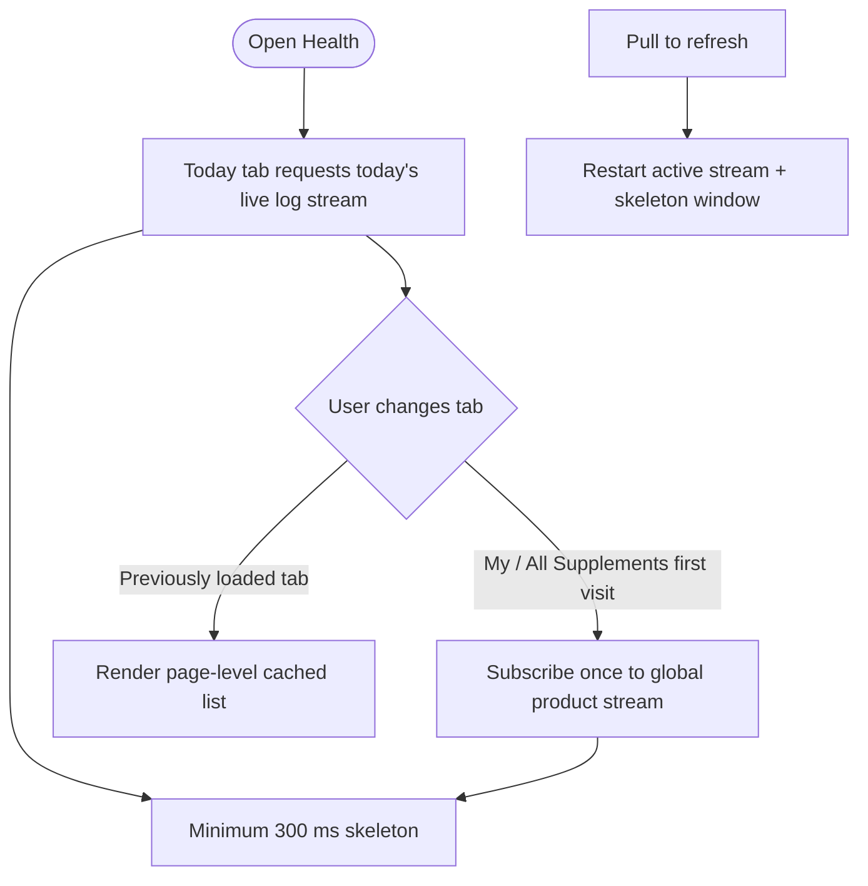
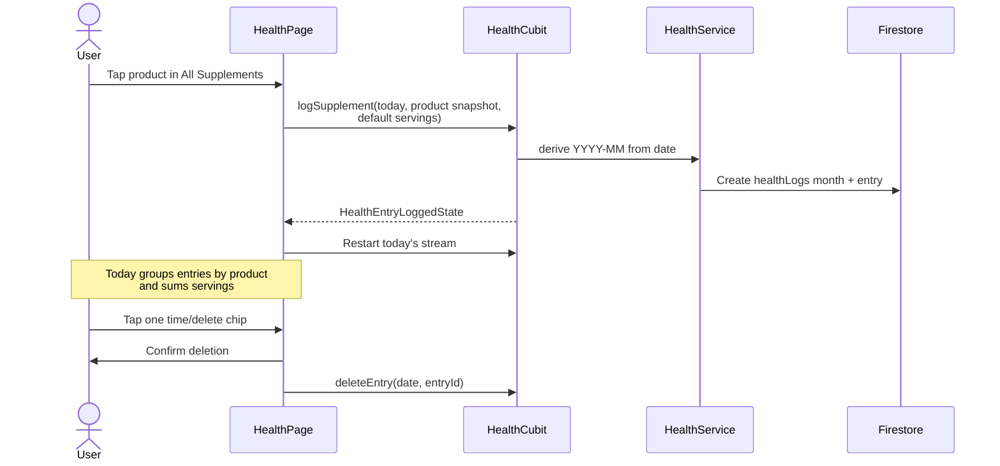
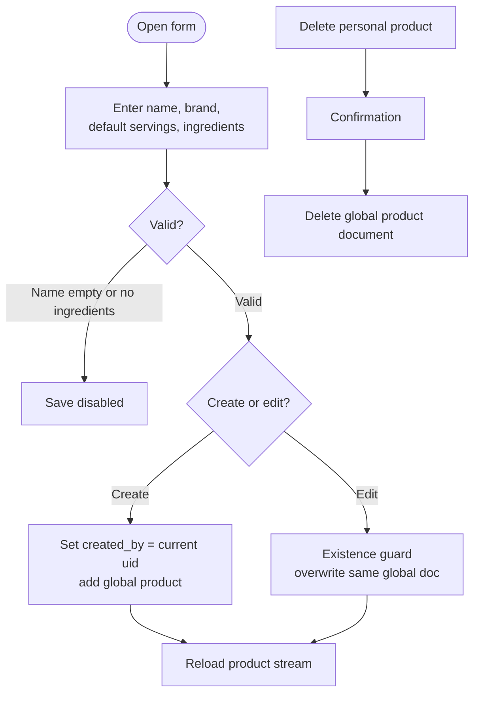

# Health & supplements

> **Status:** ✅ Implemented
> **Last updated:** 2026-07-22

## 1. Summary

Lets users log supplement servings for today and browse/manage a shared supplement-product
catalog. The page has lazy-loaded Today, My Supplements, and All Supplements tabs; health logs
are user-owned while product documents live in a global Firestore collection.

## 2. Entry points & navigation

- **In:** Main Shell tab 3 (`HealthRoute`, `maintainState: false`).
- **Out:** no route changes; create/edit forms and confirmations are modal dialogs.
- **Cross-feature use:** Calendar can log/delete health entries for any selected day; Stats aggregates yearly logs and product nutrients.

## 3. Key files

| Layer | File |
| ----- | ---- |
| Page | [health_page.dart](../../lib/presentation/pages/health/health_page.dart) |
| Cubit + states | [health_cubit.dart](../../lib/cubit/health/health_cubit.dart) · [health_states.dart](../../lib/cubit/health/health_states.dart) |
| Service | [health_service.dart](../../lib/service/health/health_service.dart) · [health_service_exceptions.dart](../../lib/service/health/health_service_exceptions.dart) |
| Source | [health_source.dart](../../lib/data/remote/supplement/health_source.dart) |
| DTOs | [supplement_product_dto.dart](../../lib/data/remote/supplement/supplement_product_dto.dart) · [supplement_log_dto.dart](../../lib/data/remote/supplement/supplement_log_dto.dart) · [product_ingredient_dto.dart](../../lib/data/remote/supplement/product_ingredient_dto.dart) |
| Mapper | [supplement_mapper.dart](../../lib/data/mappers/supplement_mapper.dart) |
| Models | [supplement_product.dart](../../lib/model/supplement_product.dart) · [supplement_log.dart](../../lib/model/supplement_log.dart) |
| Reusable UI | [search_input.dart](../../lib/presentation/controls/search_input.dart) · [summary_action_card.dart](../../lib/presentation/controls/summary_action_card.dart) · [action_bottom_sheet.dart](../../lib/presentation/controls/action_bottom_sheet.dart) · [pull_to_refresh.dart](../../lib/presentation/controls/pull_to_refresh.dart) |
| Localization keys | prefix: `health*` |

## 4. Data model & Firestore

### Supplement products

**Path:** `supplementProducts/{productId}` (global catalog)

| Field | Type | Meaning |
| ----- | ---- | ------- |
| `name` | String | Product name |
| `brand` | String | Optional/possibly empty brand |
| `ingredients` | List<Map> | `{ std_id, name, amount, unit }` snapshots |
| `servings_per_day_default` | Number | Quantity used by quick-log |
| `created_by` | String? | User UID for personal-product ownership |
| `verified` | Bool? | Optional global verification marker |

### Health logs

**Path:** `users/{uid}/healthLogs/{YYYY-MM}/entries/{entryId}`

| Field | Type | Meaning |
| ----- | ---- | ------- |
| `date` | `YYYY-MM-DD` String | Logical log date |
| `product_id` | String | Product reference |
| `product_name` / `product_brand` | String? | Historical display snapshots |
| `servings_taken` | Number | Logged serving quantity |
| `timestamp` | Timestamp? | Time used by Today chips |

Creating a log first merge-writes the month document so account cleanup can enumerate it.
The source accepts legacy camelCase field aliases when reading products/logs but writes snake_case.

## 5. Cubit states

| State | Emitted when | UI response |
| ----- | ------------ | ----------- |
| `PendingState` | A stream subscription or guarded mutation begins | Show the relevant skeleton / suppress duplicate mutations |
| `HealthDayEntriesLoadedState` | Today's/day stream updates | Cache entries and render grouped product cards |
| `HealthMonthEntriesLoadedState` | A monthly log stream updates (used by other surfaces) | Expose month entries |
| `HealthProductsLoadedState` | Global product stream updates | Cache all products and filter `createdBy == uid` for My Supplements |
| `HealthEntryLoggedState` / `HealthEntryDeletedState` | Log mutation succeeds | Reload Today stream |
| `HealthProductSavedState` / `HealthProductDeletedState` | Product mutation succeeds | Reload product stream |
| `SomethingWentWrongState` | Stream or mutation fails | Release skeleton and show generic snackbar |

## 6. User workflows

### 6.1 Lazy tab loading and refresh

**In plain English:**

1. Opening the page loads only today's entries; products are not requested yet.
2. The first visit to either product tab opens one global catalog stream; the same payload serves both tabs.
3. The widget caches the last Today/all/my lists because mutation states temporarily replace loaded cubit states.
4. Pull-to-refresh restarts only the active data stream and enforces a 300 ms skeleton window.
5. Search is local UI state (`ValueNotifier`) and filters name or brand client-side.

### 6.2 Log and delete today's servings

**In plain English:**

1. Tapping an All Supplements card quick-logs its default servings for today; values ≤ 0 become 1.
2. Name and brand are snapshotted into the log so display survives later product edits/deletion.
3. Today groups entries by `productId`, sums servings, and keeps one deletable time chip per original entry.
4. Deleting requires confirmation and removes only that entry, not the product.

### 6.3 Create, edit, and delete a product

**In plain English:**

1. The modal requires a non-empty name and at least one ingredient.
2. Ingredients are entered manually; their `stdId` is generated from a local slug, and supported units are mg/mcg/g/IU/ml.
3. Create stamps `createdBy` with the current UID; only products whose `createdBy` matches the user show edit/delete actions.
4. Edit checks the product still exists before overwriting it.
5. Delete removes the product document after confirmation; existing log snapshots remain.

## 7. Business rules & edge cases

- Log/service methods derive `YYYY-MM` from the canonical `date` string; callers never pass both.
- All writes use `guardedAction()` to prevent duplicate taps.
- Products are globally readable. Firestore rules require `created_by` (or legacy `createdBy`) to equal the authenticated UID on create/update/delete and prevent ownership transfer; the service itself does not duplicate that ownership check.
- `HealthService.updateProduct` has an existence guard; delete does not.
- Product stream read is ordered by name. The page derives My Supplements from the global stream rather than calling `watchMyProducts`.
- Health source reads both snake_case and selected camelCase legacy field names.
- A stream error replaces the active cubit state with a generic error, while page caches preserve any previously rendered data.
- The form defaults invalid servings to 1 and rejects non-positive ingredient amounts without inline error text.

## 8. Tests

| Test file | Covers |
| --------- | ------ |
| [health_cubit_test.dart](../../test/cubit/health/health_cubit_test.dart) | day/product streams, log/delete states, errors |
| [health_service_test.dart](../../test/service/health/health_service_test.dart) | delegation, date/month derivation, product update guard |
| [health_page_test.dart](../../test/presentation/pages/health/health_page_test.dart) | lazy initial load, empty Today, product-tab search, quick log |
| [supplement_product_dto_test.dart](../../test/data/remote/supplement/supplement_product_dto_test.dart) | product serialization |
| [supplement_log_dto_test.dart](../../test/data/remote/supplement/supplement_log_dto_test.dart) | log serialization |
| [product_ingredient_dto_test.dart](../../test/data/remote/supplement/product_ingredient_dto_test.dart) | ingredient serialization |

**Coverage gaps:** Firestore source queries/writes, product form CRUD widget flow, confirmation paths, grouped-serving deletion, ownership/security enforcement, and monthly cubit loading.

## 9. Known limitations & improvement candidates

- The documented/shared `ingredients` collection is not queried or auto-seeded by current code; ingredient entry is manual. Add a real ingredient source/autocomplete before claiming standardized catalog behavior.
- Product ownership is enforced by Firestore rules and UI presentation, but not duplicated in `HealthService`; emulator-backed security-rule tests should be added.
- Deleting a product can leave logs referencing a missing product (display snapshots mitigate this) and can affect other users because the catalog is global.
- The page mixes local cache/skeleton orchestration with cubit state; a future state redesign could emit combined immutable page data and reduce widget complexity.
