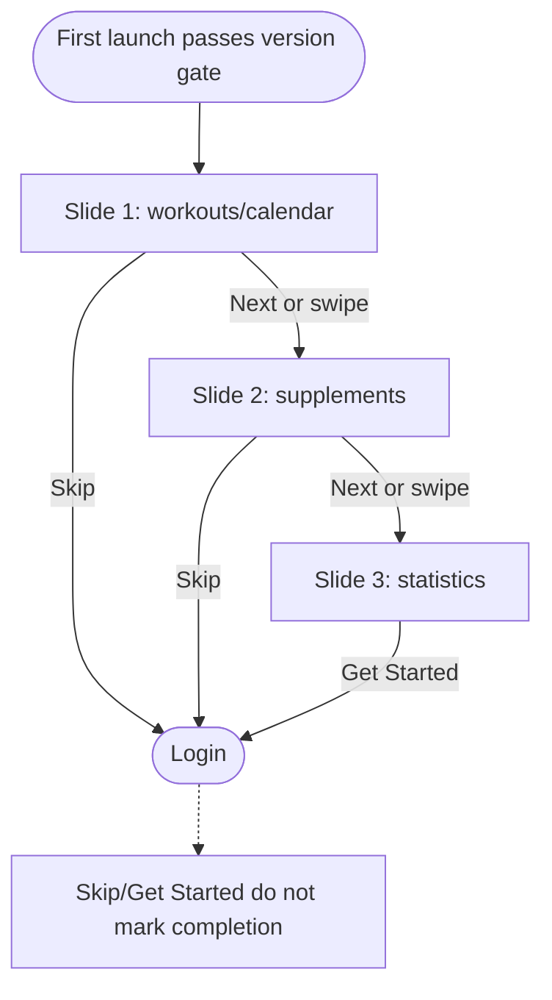
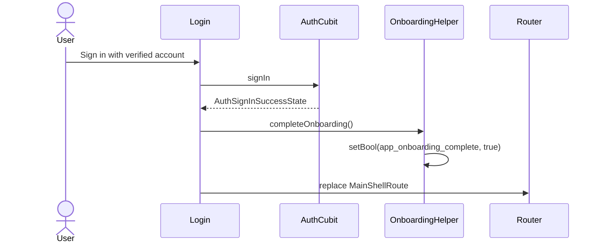
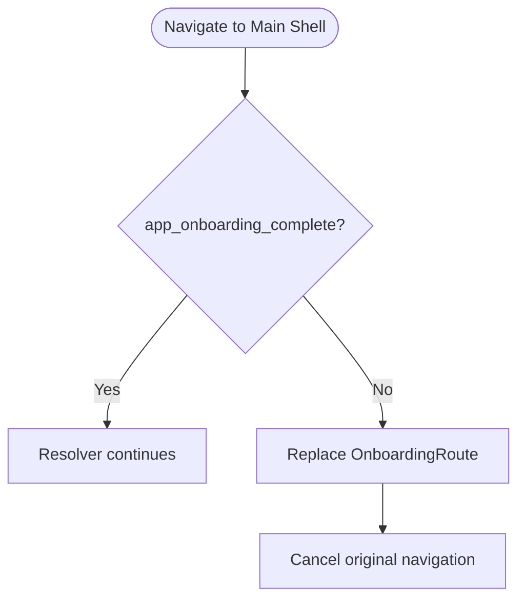

# Onboarding

> **Status:** ✅ Implemented
> **Last updated:** 2026-07-22

## 1. Summary

A three-slide, first-launch walkthrough for workouts, supplements, and statistics. The walkthrough
routes to Login; the local completion flag is intentionally written only after the first successful
verified sign-in, not when Skip/Get Started is tapped.

## 2. Entry points & navigation

- **In:** `SplashCubit` routes to `OnboardingRoute` when `OnboardingHelper.isFirstLaunch` is true.
- **Defense in depth:** `OnboardingGuard` blocks direct navigation to `MainShellRoute` while the flag remains incomplete.
- **Out:** Skip or Get Started replaces Onboarding with `LoginRoute`.
- **Completion:** `LoginPage` calls `OnboardingHelper.completeOnboarding()` only after `AuthSignInSuccessState`.

## 3. Key files

| Layer | File |
| ----- | ---- |
| Page | [onboarding_page.dart](../../lib/presentation/pages/onboarding/onboarding_page.dart) |
| Persistence helper | [onboarding_helper.dart](../../lib/presentation/helpers/onboarding_helper.dart) |
| Guard | [onboarding_guard.dart](../../lib/core/guards/onboarding_guard.dart) |
| Cold-launch decision | [splash_cubit.dart](../../lib/cubit/splash/splash_cubit.dart) |
| Completion call site | [login_page.dart](../../lib/presentation/pages/auth/login_page.dart) |
| Localization keys | prefix: `onboarding*` |

## 4. Data model & persistence

No Firestore data and no cubit. `OnboardingHelper` wraps `SharedPreferences`:

| Key | Value | Meaning |
| --- | ----- | ------- |
| `app_onboarding_complete` | Bool | Missing/false → show onboarding; true → onboarding completed on this device |

The flag is per app install/device and is unrelated to the Firebase user profile.

## 5. Page state

Onboarding has no domain cubit. Local widget state is sufficient:

| State | Owner | Purpose |
| ----- | ----- | ------- |
| `_currentPage` | `State` | Active slide index (0–2) |
| `PageController` | `State` | Swipe and animated Next navigation |
| `OnboardingHelper.isFirstLaunch` | `SharedPreferences` helper | Cold-launch and guard decision |

## 6. User workflows

### 6.1 View, swipe, skip, or finish

**In plain English:**

1. The page builds three localized slides with illustrative in-app previews.
2. Users can swipe the `PageView` or tap Next.
3. Skip is visible on the first two slides and hidden (while retaining layout space) on the last.
4. Skip and Get Started both replace the route with Login.
5. Merely viewing or leaving onboarding does not set the completion flag.

### 6.2 Persist completion after verified sign-in

**In plain English:**

1. Completion is tied to the first successful verified sign-in.
2. The local flag then prevents Splash from showing onboarding again on that device.
3. `OnboardingGuard` also allows Main Shell once the flag is true.
4. Clearing app data/reinstalling resets the walkthrough even for an existing account.

### 6.3 Direct-route defense

**In plain English:**

1. Splash normally handles onboarding before auth routing.
2. The guard independently redirects incomplete direct/deep-link attempts to Onboarding.
3. Auth guarding is a separate concern; both conditions apply to Main Shell.

## 7. Business rules & edge cases

- `isFirstLaunch` is true for missing **or explicit false** preference values.
- Onboarding is local and not account-specific; signing in once suppresses it for any later account on the same install.
- Skip does not suppress onboarding on the next cold launch unless the user subsequently signs in successfully.
- `completeOnboarding()` is awaited by neither the Login listener nor router transition; the preference write starts before navigation, but a storage failure is not surfaced.
- Page previews use local/mock visuals only; they do not load user data.
- `_currentPage` is trivial visual state, so `setState` is appropriate under project rules.

## 8. Tests

| Test file | Covers |
| --------- | ------ |
| [onboarding_page_test.dart](../../test/presentation/pages/onboarding/onboarding_page_test.dart) | slide copy, Next, swipe, Skip, Get Started, final-page controls |
| [onboarding_helper_test.dart](../../test/presentation/helpers/onboarding_helper_test.dart) | missing/false/true preference and completion write |
| [splash_cubit_test.dart](../../test/cubit/splash/splash_cubit_test.dart) | first-launch route decision |

**Coverage gaps:** `OnboardingGuard`, Login's completion call/order, persistence failure, app-restart behavior, and visual previews across screen sizes/locales.

## 9. Known limitations & improvement candidates

- Completion is per device rather than per account.
- A user who intentionally skips but does not sign in sees onboarding again after restart; if Skip should be permanent, write a separate “seen” flag.
- No accessibility/semantics-specific tests for the preview-heavy slides.
- No migration/versioning for showing materially new onboarding content to existing users.
