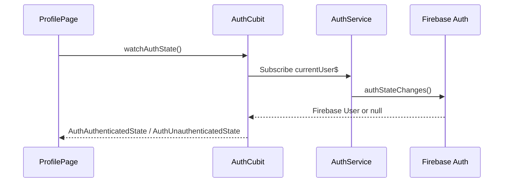
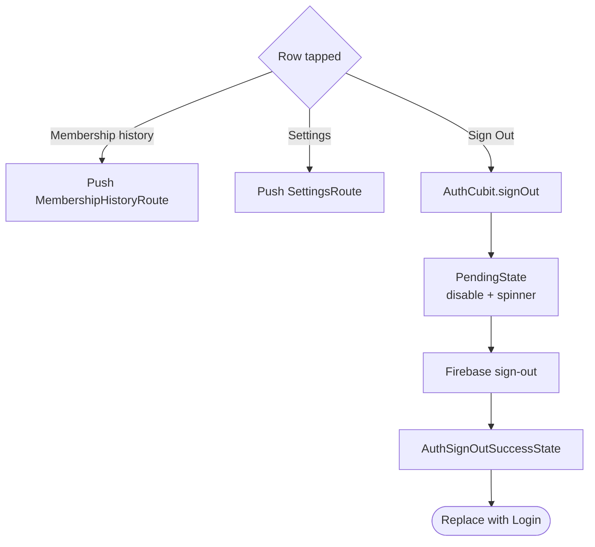

# Profile

> **Status:** ✅ Implemented
> **Last updated:** 2026-07-22

## 1. Summary

Displays the current Firebase Auth user's identity and verification status, provides navigation to
Membership History and Settings, and exposes runtime sign-out.

## 2. Entry points & navigation

- **In:** Main Shell tab 4 (`ProfileRoute`).
- **Out:** `MembershipHistoryRoute`, `SettingsRoute`, or `LoginRoute` after sign-out/unauthenticated state.
- The page is under the guarded Main Shell and gets a fresh `AuthCubit` through `AutoRouteWrapper`.

## 3. Key files

| Layer | File |
| ----- | ---- |
| Page | [profile_page.dart](../../lib/presentation/pages/profile/profile_page.dart) |
| Cubit + states | [auth_cubit.dart](../../lib/cubit/auth/auth_cubit.dart) · [auth_states.dart](../../lib/cubit/auth/auth_states.dart) |
| Auth service/model | [auth_service.dart](../../lib/service/auth/auth_service.dart) · [auth_user.dart](../../lib/model/auth_user.dart) |
| Navigation targets | [gym_membership.md](gym_membership.md) · [settings.md](settings.md) |
| Localization keys | prefix: `profile*` |

## 4. Data source

Profile does not read `users/{uid}`. It subscribes to `FirebaseAuth.authStateChanges()` through
`AuthService.currentUser$`, which maps UID, email, `displayName`, and `emailVerified` into
`AuthUser`. Registration mirrors Firestore `displayName` onto Firebase Auth so Profile can render
without a Firestore round trip.

## 5. Cubit states

| State | Emitted when | UI response |
| ----- | ------------ | ----------- |
| `AuthAuthenticatedState` | Firebase auth stream emits a user | Render identity and verification badge |
| `AuthUnauthenticatedState` | Stream emits null | Replace with Login |
| `PendingState` | Sign-out begins | Disable row and show small spinner |
| `AuthSignOutSuccessState` | Sign-out completes | Replace with Login |
| `SomethingWentWrongState` | Auth stream/sign-out fails | Show generic snackbar |

## 6. User workflows

### 6.1 Load identity

**In plain English:**

1. Page mount starts the auth-state subscription.
2. Auth user data populates the avatar, display name, email, and verified badge.
3. Display name falls back to a localized “User”; email falls back to `-`.
4. The avatar initial uses display name first, then email, then `?`.
5. A null auth event immediately redirects to Login.

### 6.2 Navigate or sign out

**In plain English:**

1. Manage rows push Membership History or Settings and preserve the Profile tab below them.
2. Sign-out is a guarded mutation; duplicate taps are ignored while pending.
3. Both explicit sign-out success and a runtime unauthenticated stream event route to Login.

## 7. Business rules & edge cases

- Profile deliberately uses the Firebase Auth profile cache, not Firestore, for fast rendering.
- A failed best-effort display-name mirror during registration can leave Profile showing localized “User” even though Firestore has the real name.
- The verified badge appears only when `emailVerified == true`; `AuthGuard` now prevents unverified users from entering Main Shell.
- The page itself has no retry/loading skeleton for the initial auth stream; before the first user event it renders fallback identity values.
- Sign-out errors restore the row and show a snackbar.

## 8. Tests

| Test file | Covers |
| --------- | ------ |
| [profile_page_test.dart](../../test/presentation/pages/profile/profile_page_test.dart) | identity/sections, Membership + Settings navigation, sign-out callback, unauthenticated redirect |
| [auth_cubit_test.dart](../../test/cubit/auth/auth_cubit_test.dart) | auth stream mapping and sign-out states |
| [auth_service_test.dart](../../test/service/auth/auth_service_test.dart) | Firebase-user mapping and sign-out delegation |

**Coverage gaps:** fallback name/avatar variants, verification badge absence, pending/error UI, long-name overflow, and real Firebase Auth stream integration.

## 9. Known limitations & improvement candidates

- Firestore is described as the profile source of truth, but this page never hydrates it; add profile-repair/hydration if Firebase `displayName` is missing or stale.
- No profile editing or avatar upload.
- Initial fallback UI can briefly appear before the first auth event; a dedicated auth-loading state could avoid that flash.
