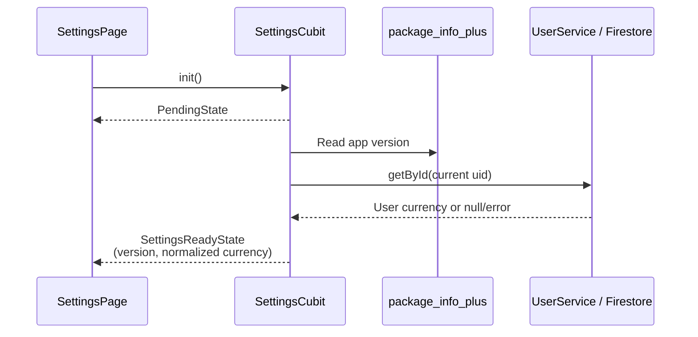
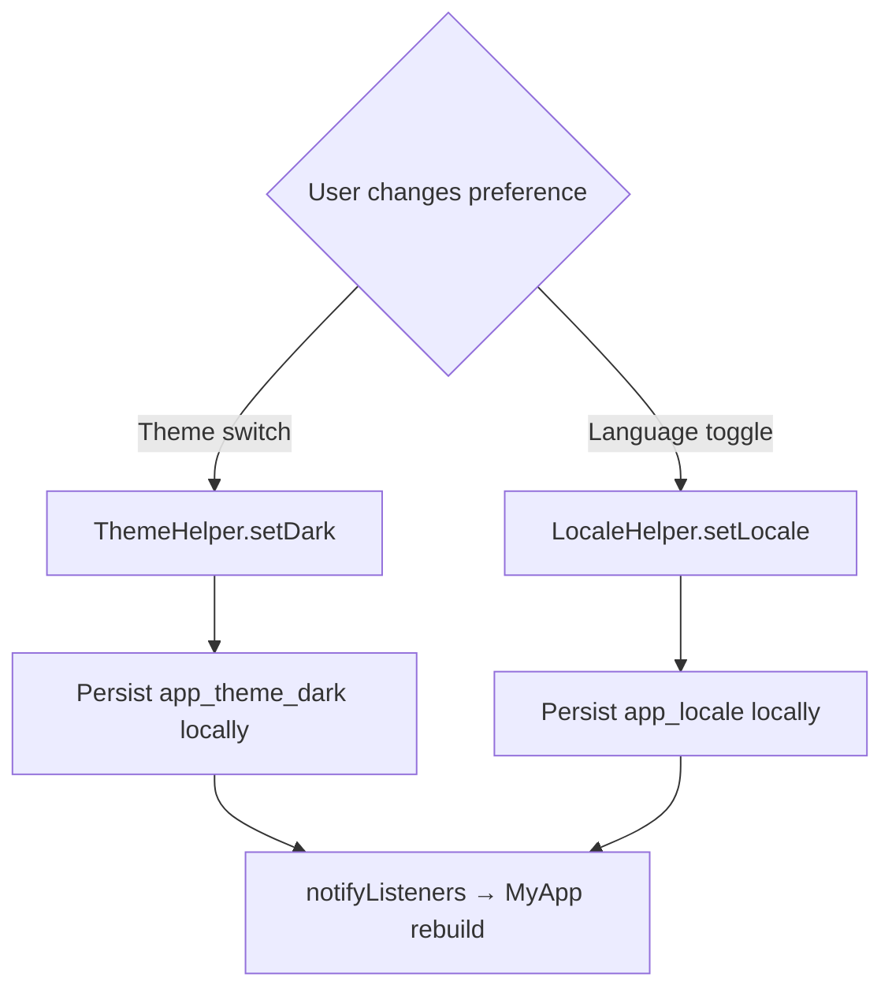
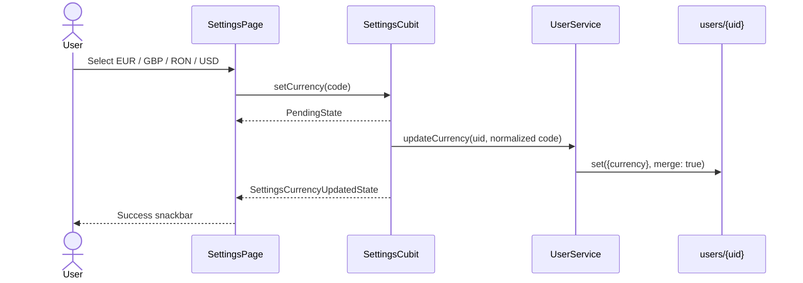
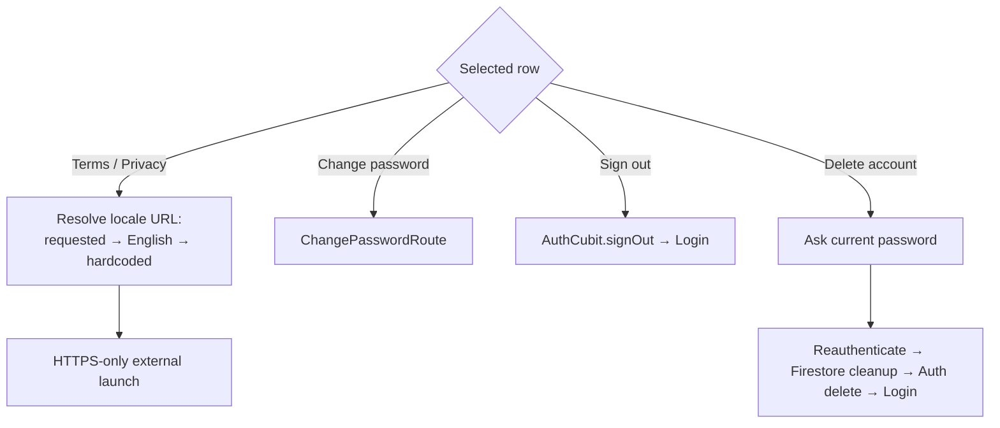

# Settings

> **Status:** ✅ Implemented
> **Last updated:** 2026-07-23

## 1. Summary

Central account/preferences screen for local theme and language, Firestore-backed account
default currency, app version, legal links, password change, sign-out, and permanent account
deletion.

## 2. Entry points & navigation

- **In:** Profile → Settings (`SettingsRoute`, guarded by `AuthGuard`, `maintainState: false`).
- **Out:** back to Profile; `ChangePasswordRoute`; external legal URLs; Login after sign-out/deletion.
- The page receives fresh `SettingsCubit` and `AuthCubit` instances through `AutoRouteWrapper`.

## 3. Key files

| Layer | File |
| ----- | ---- |
| Page | [settings_page.dart](../../lib/presentation/pages/settings/settings_page.dart) |
| Cubit + states | [settings_cubit.dart](../../lib/cubit/settings/settings_cubit.dart) · [settings_states.dart](../../lib/cubit/settings/settings_states.dart) |
| Account persistence | [user_service.dart](../../lib/service/user/user_service.dart) · [user_source.dart](../../lib/data/remote/user/user_source.dart) |
| Local helpers | [theme_helper.dart](../../lib/assets/theme/theme_helper.dart) · [locale_helper.dart](../../lib/presentation/helpers/locale_helper.dart) |
| Currency rules | [currencies.dart](../../lib/core/constants/currencies.dart) |
| Auth/account actions | [auth_cubit.dart](../../lib/cubit/auth/auth_cubit.dart) · [auth.md](auth.md) |
| Legal URL cache/launcher | [app_version_status.dart](../../lib/core/app_version_status.dart) · [legal_url_launcher.dart](../../lib/core/utils/legal_url_launcher.dart) |
| Localization keys | prefix: `settings*` plus shared `profileAccount` / `errors*` |

## 4. Data model & persistence

Settings deliberately use two persistence scopes:

| Preference | Source of truth | Key / field | Scope |
| ---------- | --------------- | ----------- | ----- |
| Theme | `ThemeHelper` + `SharedPreferences` | `app_theme_dark` | This device/app install |
| Language | `LocaleHelper` + `SharedPreferences` | `app_locale` | This device/app install |
| Default currency | `users/{uid}.currency` via `SettingsCubit → UserService → UserSource` | EUR / GBP / RON / USD | Account, shared across devices |
| App version | `package_info_plus` | Runtime package metadata | Read-only |

Every registration starts with EUR, and missing/invalid legacy values normalize to EUR.
Changing language does **not** automatically change currency; the user controls it separately.

## 5. Cubit states

| State | Emitted when | UI response |
| ----- | ------------ | ----------- |
| `PendingState` | `init()` starts or currency save begins | Keep last-known values; disable currency selector while pending |
| `SettingsReadyState` | Version and best-effort profile currency are loaded | Render version + current currency |
| `SettingsCurrencyUpdatedState` | Firestore merge succeeds | Update selector and show success snackbar |
| `SomethingWentWrongState` | Unsupported value, missing auth user, or save failure | Preserve cubit getters and show generic error snackbar |

Theme and language do not emit cubit states; their `ChangeNotifier`s rebuild Settings and `MyApp`.

## 6. User workflows

### 6.1 Load Settings

**In plain English:**

1. A new page instance calls `SettingsCubit.init()` from `initState`.
2. App-version lookup failure degrades to `-`.
3. Profile read failure, missing profile, or invalid currency degrades to EUR rather than blocking Settings.
4. Local theme/language values are already available synchronously from their helpers.

### 6.2 Change theme or language

**In plain English:**

1. Theme and language are local device preferences, not Firestore mutations.
2. The helper writes `SharedPreferences` and calls `notifyListeners()`.
3. Settings updates immediately, and `MyApp` rebuilds theme or locale.
4. Changing language does not rewrite account currency; the user controls currency separately.

### 6.3 Change account default currency

**In plain English:**

1. The selector only offers the four supported codes.
2. Both cubit and service validate/normalize before writing.
3. Firestore merge changes only `currency`.
4. New blank membership forms use this value after their next page load.
5. Existing and copied membership records retain their own historical currency.

### 6.4 Legal and account actions

**In plain English:**

1. Legal URLs come from the successful Splash config cache, with English/hardcoded fallback and HTTPS validation.
2. Password change opens its dedicated authenticated route.
3. Sign-out and deletion reuse `AuthCubit`; deletion details are documented in [auth.md](auth.md#64-permanent-account-deletion).

## 7. Business rules & edge cases

- `SettingsCubit` is a fresh factory instance because `SettingsRoute` does not maintain state.
- Currency mutations use `guardedAction()`; selecting the current value is a no-op.
- Invalid currency codes never reach Firestore.
- A transient profile load failure displays EUR for that visit; there is no offline cached account currency beyond Firestore SDK caching.
- Theme defaults dark and locale defaults English when no local value exists.
- Local helper writes update UI before/while awaiting `SharedPreferences`; persistence failure is not surfaced to the user.
- The page uses separate listeners for Settings feedback and Auth side effects so a currency save cannot dismiss an Auth loading dialog.

## 8. Tests

| Test file | Covers |
| --------- | ------ |
| [settings_cubit_test.dart](../../test/cubit/settings/settings_cubit_test.dart) | init, EUR fallback, currency persistence, unsupported values |
| [settings_page_test.dart](../../test/presentation/pages/settings/settings_page_test.dart) | sections, navigation, legal/account actions, currency selector callback |
| [currencies_test.dart](../../test/core/constants/currencies_test.dart) | EUR fallback membership and currency normalization |
| [auth_cubit_test.dart](../../test/cubit/auth/auth_cubit_test.dart) | registration language persistence, unconditional EUR currency default, and account actions |

**Coverage gaps:** real Firestore currency write, helper persistence failure, local theme/language helper unit tests, and legal URL launch integration.

## 9. Known limitations & improvement candidates

- Theme and language are per-device while currency is per-account; this is intentional but could surprise multi-device users.
- No optimistic rollback/inline progress indicator specifically for currency; the selector temporarily reads from cubit getters during `PendingState`.
- The page contains multiple large sections in one widget; future settings growth should extract section widgets without introducing extra cubits.
