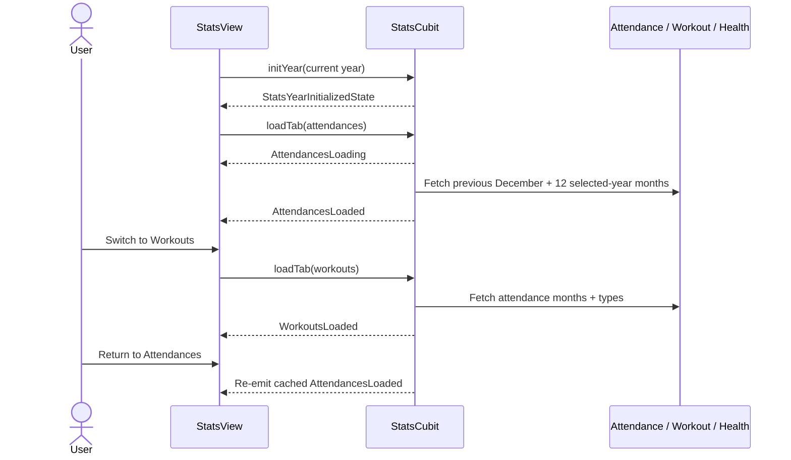
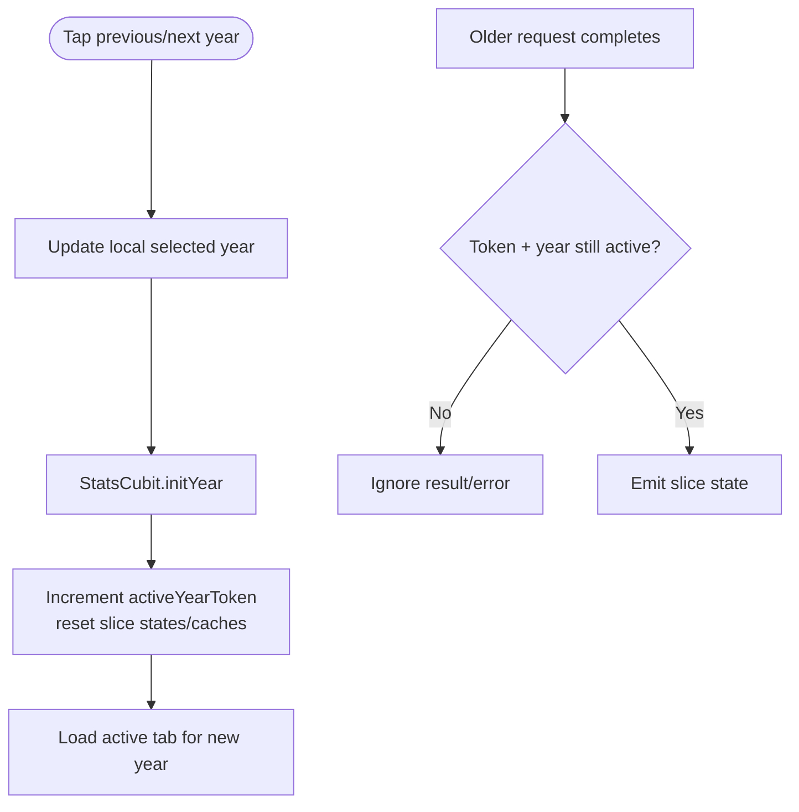
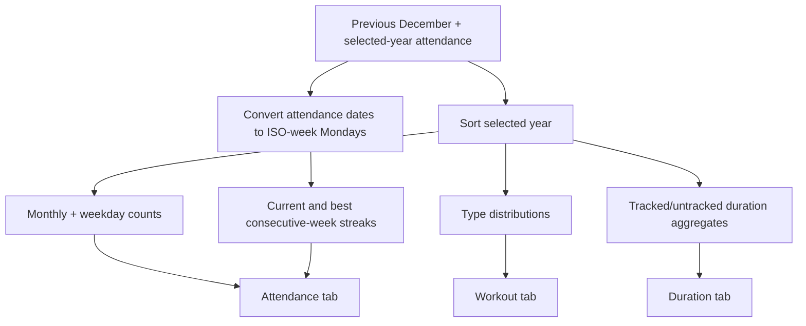
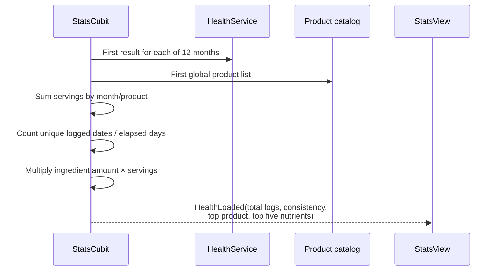

# Statistics dashboard

> **Status:** ✅ Implemented
> **Last updated:** 2026-07-22

## 1. Summary

Computes a selected year's attendance, workout-type, duration, and supplement statistics from
existing Firestore records. Four tabs load independently, cache their last successful result, and
ignore stale in-flight work after a year change.

## 2. Entry points & navigation

- **In:** Main Shell tab 2 (`StatsRoute`, `maintainState: false`).
- **Out:** no child routes; year and tab changes are local to the page.
- **Year state:** starts at the current year and is held in a `ValueNotifier<int>`; it is **not** currently synchronized to an AutoRoute query parameter.

## 3. Key files

| Layer | File |
| ----- | ---- |
| Page | [stats_page.dart](../../lib/presentation/pages/stats/stats_page.dart) |
| Cubit + states | [stats_cubit.dart](../../lib/cubit/stats/stats_cubit.dart) · [stats_states.dart](../../lib/cubit/stats/stats_states.dart) |
| Aggregate model | [attendance_stats.dart](../../lib/model/attendance_stats.dart) |
| Source services | [attendance_service.dart](../../lib/service/attendance/attendance_service.dart) · [workout_service.dart](../../lib/service/workout/workout_service.dart) · [health_service.dart](../../lib/service/health/health_service.dart) |
| Shared controls | [gym_tab_bar.dart](../../lib/presentation/controls/gym_tab_bar.dart) · [pull_to_refresh.dart](../../lib/presentation/controls/pull_to_refresh.dart) · [error_state.dart](../../lib/presentation/controls/error_state.dart) |
| Localization keys | prefix: `stats*` |

## 4. Data inputs and computed model

Stats has no dedicated Firestore collection. `StatsCubit` consumes one-shot first emissions from:

- attendance months: `users/{uid}/attendances/{YYYY-MM}/days/*`;
- workout types: `users/{uid}/trainingTypes/*`;
- health-log months: `users/{uid}/healthLogs/{YYYY-MM}/entries/*`;
- global products: `supplementProducts/*`.

`AttendanceStats` stores:

| Slice | Main computed fields |
| ----- | -------------------- |
| Attendances | yearly/current-month counts, monthly bars, weekday distribution, favorite weekdays, current/best weekly streak + date ranges |
| Workouts | yearly type distribution and per-month type distribution |
| Duration | monthly, monthly-per-type, and yearly/per-type averages; untracked-duration counts |
| Health | total log entries, elapsed-day consistency %, monthly servings, most-taken product, monthly product servings, top five nutrient totals |

## 5. Cubit states

`StatsTabKind` selects `attendances`, `workouts`, `duration`, or `health`.

| State | Emitted when | UI response |
| ----- | ------------ | ----------- |
| `StatsYearInitializedState` | Year changes | Reset every tab to a skeleton for that year |
| `StatsAttendancesLoading/Loaded/ErrorState` | Attendance slice request | Skeleton, render attendance cards/charts, or retry error |
| `StatsWorkoutsLoading/Loaded/ErrorState` | Workout slice request | Skeleton, render type distributions, or retry error |
| `StatsDurationLoading/Loaded/ErrorState` | Duration slice request | Skeleton, render duration averages/untracked counts, or retry error |
| `StatsHealthLoading/Loaded/ErrorState` | Health slice request | Skeleton, render supplement aggregates, or retry error |

Private `_SliceStatus` fields and per-slice cached loaded states coordinate requests; Stats is the
explicit project exception that does not use `guardedAction()`.

## 6. User workflows

### 6.1 Open, switch tabs, and cache slices

**In plain English:**

1. The page initializes the selected year, then loads only the active tab.
2. Each tab has independent loading/error/loaded status.
3. Returning to a loaded tab re-emits its cached state so that tab's filtered `BlocBuilder` can render immediately.
4. Workouts and Duration share cached source data per year (attendance months + type list).
5. Pull-to-refresh calls `loadTab(force: true)` for only that tab.

### 6.2 Change year and reject stale results

**In plain English:**

1. Year arrows update page-local state.
2. `initYear` invalidates all slice statuses and cached loaded states with a new token.
3. The active tab starts loading for the new year.
4. Any older request checks both token and year before emitting, preventing stale-year UI.

### 6.3 Attendance/workout/duration calculations

**In plain English:**

1. Previous December is fetched only to allow a streak to cross the year boundary.
2. A streak is consecutive ISO weeks with at least one attendance; “current” must end this week or last week.
3. For the current year, monthly count uses the current calendar month; for a past year it uses December.
4. Duration averages exclude missing/non-positive durations; missing durations are counted separately.
5. Type distributions exclude attendance records without a type ID.

### 6.4 Health calculations

**In plain English:**

1. All 12 selected-year log months and the product catalog are read concurrently.
2. Consistency is unique dates with a log divided by elapsed days (or 365/366 for a past year).
3. Most-taken product is based on summed servings.
4. Nutrient totals depend on the product's **current** ingredient list and are grouped by ingredient standard ID plus unit.

## 7. Business rules & edge cases

- Month/source errors are individually converted to empty lists, so many network failures yield an empty/partial-looking loaded state rather than the slice error state. Slice error is reserved for failures outside those catches.
- Workout-type and product-catalog errors also degrade to empty metadata.
- Workouts and Duration cache source data by year; `initYear` resets slice UI caches but keeps `_workoutDurationSourceDataByYear` for later reuse.
- Force refresh replaces the shared source cache for that year.
- Health `total logs` counts documents, while serving charts/counts sum `servingsTaken`; these are intentionally different units.
- Nutrient values with different units are not converted before ranking.
- The page's month subselectors use local widget state and default to the current month.

## 8. Tests

| Test file | Covers |
| --------- | ------ |
| [stats_cubit_test.dart](../../test/cubit/stats/stats_cubit_test.dart) | year init, independent slices, source reuse, core aggregates, stale-request rejection |
| [stats_page_test.dart](../../test/presentation/pages/stats/stats_page_test.dart) | tab shell and loaded-state rendering |

**Coverage gaps:** exhaustive streak/date boundaries, leap-year consistency, nutrient unit collisions, partial source failures, pull-to-refresh, year arrows, chart interactions, and full tab-specific widget content.

## 9. Known limitations & improvement candidates

- Selected year is not encoded in `?year=` despite older architecture notes; deep links and route restoration cannot preserve it. Add an AutoRoute query parameter if that behavior is desired.
- Twelve or thirteen month streams are opened only to consume `.first`; one-shot service methods would better express the read pattern and reduce stream overhead.
- Per-month errors silently become empty data, which can misrepresent outages as “no activity.” Carry partial/error metadata into the UI.
- Nutrient totals use current catalog composition rather than a product/ingredient snapshot from log time.
- The cubit is calculation-heavy; extracting pure aggregate calculators would improve focused testability.
