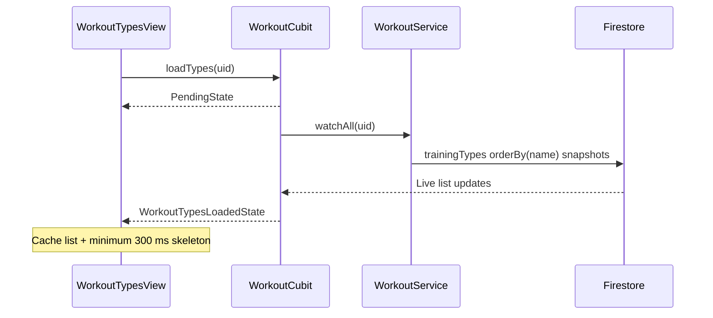
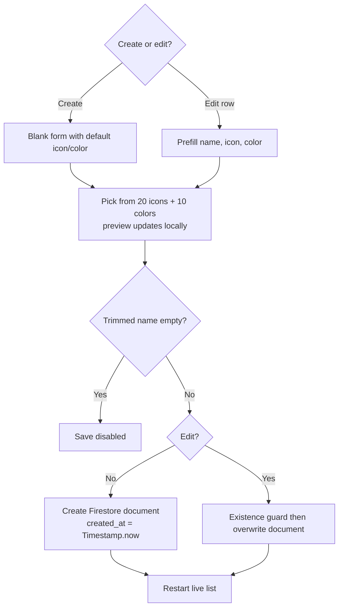

# Workout types

> **Status:** ✅ Implemented
> **Last updated:** 2026-07-22

## 1. Summary

Lets each authenticated user create a personal list of workout types (name, preset color, and
emoji icon). Calendar attendance records reference these IDs to label and color workout days.

## 2. Entry points & navigation

- **In:** Main Shell → Workouts tab → Manage workout types → `WorkoutTypesRoute` (`AuthGuard`).
- **Out:** back to Workouts.
- **Actions:** app-bar add, FAB, or empty-state CTA opens create; tapping a row edits; trash opens delete confirmation.

## 3. Key files

| Layer | File |
| ----- | ---- |
| Page | [workout_types_page.dart](../../lib/presentation/pages/workout_types/workout_types_page.dart) |
| Cubit + states | [workout_cubit.dart](../../lib/cubit/workout/workout_cubit.dart) · [workout_states.dart](../../lib/cubit/workout/workout_states.dart) |
| Service | [workout_service.dart](../../lib/service/workout/workout_service.dart) · [workout_service_exceptions.dart](../../lib/service/workout/workout_service_exceptions.dart) |
| Source | [training_type_source.dart](../../lib/data/remote/training_type/training_type_source.dart) |
| DTO + mapper | [training_type_dto.dart](../../lib/data/remote/training_type/training_type_dto.dart) · [training_type_mapper.dart](../../lib/data/mappers/training_type_mapper.dart) |
| Model | [training_type.dart](../../lib/model/training_type.dart) |
| Controls | [action_bottom_sheet.dart](../../lib/presentation/controls/action_bottom_sheet.dart) · [confirmation_dialog.dart](../../lib/presentation/controls/confirmation_dialog.dart) · [main_list_item.dart](../../lib/presentation/controls/main_list_item.dart) · [pull_to_refresh.dart](../../lib/presentation/controls/pull_to_refresh.dart) |
| Localization keys | prefix: `workoutTypes*` |

## 4. Data model & Firestore

**Path:** `users/{uid}/trainingTypes/{typeId}`

| Field | Type | Meaning |
| ----- | ---- | ------- |
| `name` | String | User-visible type name (form max 30 characters) |
| `color` | String | Hex color selected from ten presets |
| `icon` | String? | Emoji selected from twenty presets |
| `created_at` | Timestamp? | Set with device `Timestamp.now()` on create |

The document ID is supplied by Firestore and excluded from serialized fields. Reads are live and
ordered by `name`.

## 5. Cubit states

| State | Emitted when | UI response |
| ----- | ------------ | ----------- |
| `PendingState` | Stream subscription or mutation starts | Skeleton / duplicate-action guard |
| `WorkoutTypesLoadedState` | Firestore stream updates | Cache list and render empty/list UI |
| `WorkoutTypeCreatedState` | Create succeeds | Restart list stream |
| `WorkoutTypeUpdatedState` | Update succeeds | Restart list stream |
| `WorkoutTypeDeletedState` | Delete succeeds | Restart list stream |
| `SomethingWentWrongState` | Stream/mutation fails or update target vanished | Release skeleton and show snackbar |

## 6. User workflows

### 6.1 Load and refresh



**In plain English:**

1. Page mount subscribes to the user's sorted training-type collection.
2. The page caches the latest list because mutation states temporarily replace the loaded state.
3. Skeletons remain visible for at least 300 ms to avoid flashes.
4. Pull-to-refresh cancels/restarts the same live subscription.

### 6.2 Create or edit



**In plain English:**

1. Create opens defaults; edit opens the selected record.
2. Name, icon, color, and preview are local ephemeral form state.
3. Save is disabled for a blank trimmed name; the field also has a 30-character limit.
4. Update verifies that the document still exists before writing.
5. Success restarts the list stream; Firestore would also eventually emit the live change.

### 6.3 Delete

```mermaid
flowchart TD
    A([Tap trash]) --> B[Confirmation dialog]
    B -->|Cancel| C([No change])
    B -->|Delete| D[guardedAction]
    D --> E[Delete trainingTypes/{id}]
    E --> F[WorkoutTypeDeletedState]
    F --> G[Restart list stream]
```

**In plain English:**

1. Delete always asks for confirmation.
2. The cubit prevents duplicate taps while pending.
3. The service delegates directly to Firestore; deleting a missing document is effectively harmless.
4. Success reloads the live list.

## 7. Business rules & edge cases

- All mutations use `guardedAction()`.
- Update has `TrainingTypeNotFoundException`; delete has no existence guard.
- Source update uses `set()` (replace), not merge.
- The update mapper receives no `createdAt`, so editing overwrites `created_at` with null/removes its previous value from the serialized document.
- Invalid persisted hex strings render with the fallback indigo color; the form only writes presets.
- Calendar attendance stores the type ID. Deleting a type does not rewrite historical attendance records, so those records may lose a resolvable label/icon.
- Both app-bar add and FAB expose create; the empty state adds a third create entry point.

## 8. Tests

| Test file | Covers |
| --------- | ------ |
| [workout_cubit_test.dart](../../test/cubit/workout/workout_cubit_test.dart) | live load, CRUD states, update-not-found/error mapping |
| [workout_service_test.dart](../../test/service/workout/workout_service_test.dart) | delegation and update existence guard |
| [workout_types_page_test.dart](../../test/presentation/pages/workout_types/workout_types_page_test.dart) | initial load, skeleton, empty state, list rendering, confirmed delete |
| [training_type_dto_test.dart](../../test/data/remote/training_type/training_type_dto_test.dart) | serialization and document-ID exclusion |

**Coverage gaps:** Firestore source/mapper, create/edit form submission and preset selection, refresh timing, invalid color fallback, and historical attendance after deletion.

## 9. Known limitations & improvement candidates

- Preserve `created_at` on update instead of overwriting it with null.
- Prevent or explain deletion when historical attendance references the type, or snapshot type name/icon/color into attendance records.
- No uniqueness rule for names; users can create visually duplicate types.
- Page-level list caching and manual stream restart add complexity; a combined immutable page state could simplify the widget.
