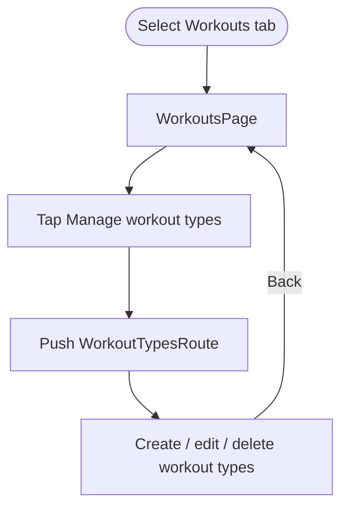

# Workouts hub

> **Status:** ✅ Implemented
> **Last updated:** 2026-07-22

## 1. Summary

A lightweight Main Shell container reserved for workout-related capabilities. Its current and only
entry is Manage workout types; it intentionally owns no domain state or persistence.

## 2. Entry points & navigation

- **In:** Main Shell tab 1 (`WorkoutsRoute`).
- **Out:** tapping Manage workout types pushes `WorkoutTypesRoute`; back returns to this tab.
- Main Shell authentication/onboarding guards protect the tab; the pushed route also has `AuthGuard`.

## 3. Key files

| Layer | File |
| ----- | ---- |
| Page | [workouts_page.dart](../../lib/presentation/pages/workouts/workouts_page.dart) |
| Router | [app_router.dart](../../lib/core/app_router.dart) |
| Destination feature | [workout_types.md](workout_types.md) |
| Localization keys | prefix: `workouts*` |

## 4. Data model & persistence

None. This page is navigation-only and does not create a cubit, service, source, or Firestore read.

## 5. Page state

`WorkoutsPage` is a `StatelessWidget`. It derives theme/localization from context and has no local or
domain state.

## 6. User workflows

### Open workout-type management

**In plain English:**

1. Selecting the second bottom-navigation destination shows the Workouts hub.
2. The single tile pushes the standalone Workout Types page.
3. Back navigation reveals the existing Workouts tab again.
4. All type data/state belongs to [Workout Types](workout_types.md), not this hub.

## 7. Business rules & edge cases

- The page stays stateless until a real workout domain capability is added.
- It uses `context.router.push`, preserving the Main Shell tab underneath.
- There is no empty/error/loading state because the page performs no data read.
- Adding future sessions/templates/plans should create their own vertical slices rather than expanding this page into a business-logic owner.

## 8. Tests

There is currently no direct `WorkoutsPage` widget test. Navigation is indirectly represented by
router/Main Shell tests, while Workout Types has its own cubit/service/page tests.

**Coverage gap:** add a small widget test asserting the localized tile and `WorkoutTypesRoute` push.

## 9. Known limitations & improvement candidates

- The tab currently adds one navigation tap before reaching its only capability.
- It is intentionally a placeholder for future workout sessions, templates, or plans; avoid adding speculative UI until one of those features is designed.
