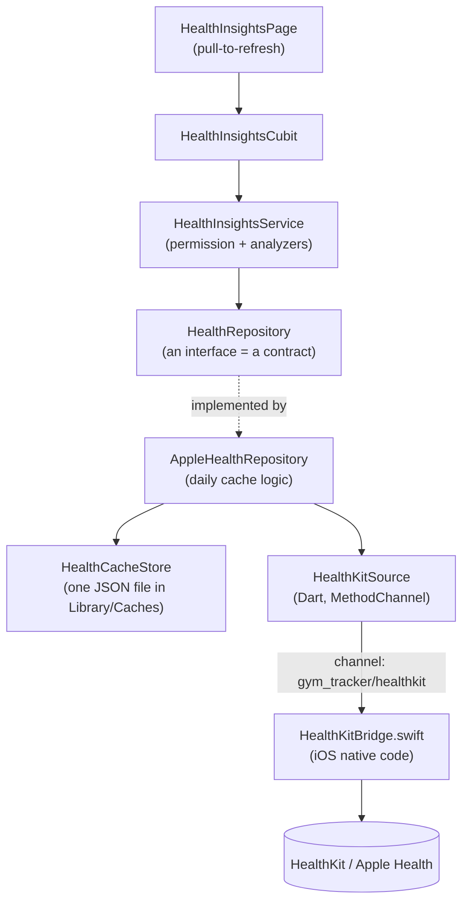
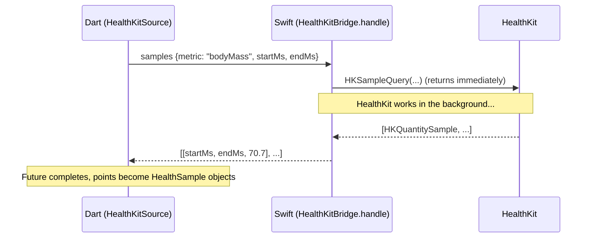
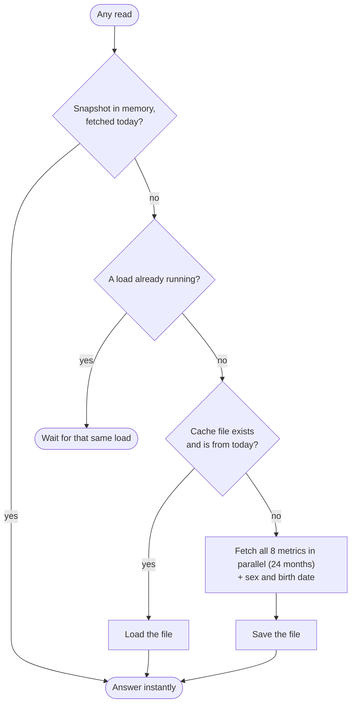

# How Health Insights gets its data from the iPhone

> **A guide written for a student.** You do not need to know HealthKit, Swift, or Flutter
> platform channels beforehand — every new word is explained the first time it appears.
> By the end you will be able to follow one piece of data (say, your weight) from the
> Apple Health app, through Swift, through Flutter, into a chart on screen — and add a new
> kind of data yourself.
>
> **Last updated:** 2026-10-12 · **Applies to:** iOS only (Android shows none of this) ·
> **Feature map:** [`docs/features/health_insights.md`](../features/health_insights.md)

---

## Table of contents

1. [The problem in one minute](#1-the-problem-in-one-minute)
2. [The big picture](#2-the-big-picture)
3. [Step 0 — Telling iOS that the app may use HealthKit](#3-step-0--telling-ios-that-the-app-may-use-healthkit)
4. [Step 1 — The Swift bridge](#4-step-1--the-swift-bridge)
5. [Step 2 — The method channel (how Dart and Swift talk)](#5-step-2--the-method-channel-how-dart-and-swift-talk)
6. [Step 3 — Turning raw points into the app's models](#6-step-3--turning-raw-points-into-the-apps-models)
7. [Step 4 — The repository and the daily cache](#7-step-4--the-repository-and-the-daily-cache)
8. [Step 5 — The service: permission, reading, "no data"](#8-step-5--the-service-permission-reading-no-data)
9. [Step 6 — Cubit and screen: `load` vs `refresh`, and keeping Android clean](#9-step-6--cubit-and-screen-load-vs-refresh-and-keeping-android-clean)
10. [One full walk-through](#10-one-full-walk-through)
11. [Testing without a phone](#11-testing-without-a-phone)
12. [Trying it for real](#12-trying-it-for-real)
13. [Common problems](#13-common-problems)
14. [Exercise: add a new metric](#14-exercise-add-a-new-metric)
15. [Design decisions (the "why")](#15-design-decisions-the-why)
16. [Glossary](#16-glossary)

---

## 1. The problem in one minute

Your iPhone (and Apple Watch) constantly record health numbers: weight, heart-rate
variability, VO2 Max, calories burned, and many more. They all live in one place, the
**Apple Health** database, stored **encrypted on the phone**.

Three facts shape everything else in this guide:

1. **An app cannot open that database.** It must ask an iOS framework called
   **HealthKit**, and the user must say yes, one data type at a time.
2. **HealthKit is a Swift/Objective-C API.** Flutter code is Dart, and Dart cannot call
   Swift directly. We need a small "translator" between them: a **platform channel**.
3. **Health data is private.** Our rules: read-only, kept on the phone, never sent to
   Firebase or any server (see [`.github/rules.md`](../../.github/rules.md), section
   *Apple Health*).

So the job is: **ask permission → query HealthKit in Swift → pass the numbers to Dart →
keep a copy on the phone for the day → show charts.** The rest of this guide is that
sentence, one arrow at a time.

> **Concept — "read-only".** We request *read* access only. The app can never write or
> change anything in Apple Health. In code that is `toShare: nil` (share = write).

---

## 2. The big picture



Read it top to bottom: the screen asks a cubit, the cubit asks a service, the service
asks "the repository", and only the repository's implementation knows that the data
comes from an iPhone.

| Layer | File | Its one job |
| ----- | ---- | ----------- |
| Screen | [`health_insights_page.dart`](../../lib/presentation/pages/health_insights/health_insights_page.dart) | Show cards; call `refresh()` on pull-to-refresh |
| Cubit | [`health_insights_cubit.dart`](../../lib/cubit/health_insights/health_insights_cubit.dart) | Turn a service result into a screen state (loading / ready / error) |
| Service | [`health_insights_service.dart`](../../lib/service/health_insights/health_insights_service.dart) | Ask permission, read every metric, run the analyzers |
| Repository (contract) | [`health_repository.dart`](../../lib/data/health_insights/health_repository.dart) | Say *what* data exists, not *where* it comes from |
| Repository (real) | [`apple_health_repository.dart`](../../lib/data/health_insights/apple_health_repository.dart) | Read Apple Health at most once a day, cache the rest |
| Cache | [`health_cache_store.dart`](../../lib/data/health_insights/health_cache_store.dart) + [`health_snapshot.dart`](../../lib/data/health_insights/health_snapshot.dart) | Save / load one day's data as a JSON file |
| Dart ⇄ Swift | [`healthkit_source.dart`](../../lib/data/health_insights/healthkit_source.dart) | Call the Swift code through a method channel |
| Native | [`HealthKitBridge.swift`](../../ios/Runner/HealthKitBridge.swift) | Talk to HealthKit |

> **Concept — an interface is a contract.** `HealthRepository` lists the questions the
> rest of the app may ask ("give me weight samples between these dates"). The app does
> not care who answers. In production the answer comes from an iPhone; in unit tests it
> comes from a JSON file. Everything above the repository is identical in both cases.
> This is why the whole feature can be tested on a laptop with no phone.

---

## 3. Step 0 — Telling iOS that the app may use HealthKit

Before a single line of Swift runs, iOS needs two declarations. Without them the request
is refused (or the app crashes).

### 3.1 The entitlement (permission to *use the HealthKit framework*)

An **entitlement** is a signed claim embedded in the app: "this app is allowed to use
capability X". File: [`ios/Runner/Runner.entitlements`](../../ios/Runner/Runner.entitlements)

```xml
<dict>
    <key>com.apple.developer.healthkit</key>
    <true/>
</dict>
```

- `com.apple.developer.healthkit` — "this app uses HealthKit".
- There is deliberately **no** `com.apple.developer.healthkit.access` key. It is only for
  clinical health records, which we do not use. Xcode adds it (as an empty list) when you
  add the HealthKit capability, but even an empty one asks Apple for the *Verifiable Health
  Records* capability, which a free Personal Team cannot have, so Xcode refuses to create a
  provisioning profile (see section 13).
- The file is linked to the app in `ios/Runner.xcodeproj/project.pbxproj` with
  `CODE_SIGN_ENTITLEMENTS = Runner/Runner.entitlements;` (for Debug, Release and Profile).
- When you build on a real device, Xcode also switches the **HealthKit capability** on for
  the app's *App ID* in your Apple developer account. That is why the first device build
  may ask Xcode to refresh the provisioning profile.

### 3.2 The usage description (the sentence shown in Apple's permission sheet)

File: [`ios/Runner/Info.plist`](../../ios/Runner/Info.plist)

```xml
<key>NSHealthShareUsageDescription</key>
<!-- one long line in the real file; wrapped here for readability -->
<string>Gym Tracker reads your weight, body composition, cardio fitness, heart rate
variability, heart rate recovery and energy data from Apple Health to build your Health
Insights. Your data stays on this iPhone.</string>
```

- "Share" in Apple's naming means *reading from the user's Health data*.
  (`NSHealthUpdateUsageDescription` would be for *writing*; we never write, so we do not
  declare it.)
- If this key is missing, iOS raises an exception the moment the app requests
  authorization — the app crashes. Always add it first.
- The same key is translated in `ios/Runner/en.lproj/InfoPlist.strings` and
  `ios/Runner/ro.lproj/InfoPlist.strings`, so a Romanian phone shows the Romanian text.
  (`CFBundleLocalizations` in `Info.plist` lists `en` and `ro`.)

> **Be honest in this sentence.** Apple reviewers compare it with what the app really
> reads, and the hosted privacy policy ([`legal/privacy.html`](../../legal/privacy.html))
> must say the same thing. If you add a metric later, update **both** (see the exercise).

### 3.3 Android

Nothing. HealthKit exists only on iOS. We deliberately add **no** Health Connect code and
no Android permission, and we hide every entry point on Android (section 9).

---

## 4. Step 1 — The Swift bridge

File: [`ios/Runner/HealthKitBridge.swift`](../../ios/Runner/HealthKitBridge.swift) (about
170 lines). It is the only place that imports `HealthKit`.

### 4.1 Plugging it into Flutter

The app's `AppDelegate` registers the bridge when the Flutter engine starts:

```swift
func didInitializeImplicitFlutterEngine(_ engineBridge: FlutterImplicitEngineBridge) {
  GeneratedPluginRegistrant.register(with: engineBridge.pluginRegistry)
  if let registrar = engineBridge.pluginRegistry.registrar(forPlugin: "HealthKitBridge") {
    HealthKitBridge.register(with: registrar)
  }
}
```

`register` creates a named **channel** and tells Flutter: "send every call on this channel
to my `handle` function":

```swift
static func register(with registrar: FlutterPluginRegistrar) {
  let channel = FlutterMethodChannel(name: "gym_tracker/healthkit", binaryMessenger: registrar.messenger())
  registrar.addMethodCallDelegate(HealthKitBridge(), channel: channel)
}
```

The channel name `"gym_tracker/healthkit"` is a plain string that **must be identical** on
the Dart side. It is the street address both sides use.

### 4.2 The six methods the bridge understands

`handle` is a `switch` over the method name that Dart sends:

| Method | What it does | Returns |
| ------ | ------------ | ------- |
| `isAvailable` | Is there an Apple Health store on this device? (`false` on a device without Apple Health) | `true` / `false` |
| `requestAuthorization` | Show Apple's permission sheet for our 8 metrics + sex + birth date | `true` when the sheet finished |
| `characteristics` | Read sex and date of birth | `{"sex": "male", "birthDate": "2000-01-01"}` |
| `samples` | Every reading of one metric in a date range | list of `[startMs, endMs, value]` |
| `latestSample` | Only the most recent reading of one metric | same list, at most one item |
| `dailySums` | One total per day (used for energy) | same list, one item per day |

### 4.3 The metric table: which HealthKit type, which unit

```swift
// Keys match the Dart `HealthMetric` enum names; units match what the analyzers expect.
private static let metrics: [String: Metric] = {
  var metrics: [String: Metric] = [:]
  func add(_ key: String, _ identifier: HKQuantityTypeIdentifier, _ unit: HKUnit) {
    if let type = HKQuantityType.quantityType(forIdentifier: identifier) {
      metrics[key] = Metric(type: type, unit: unit)
    }
  }
  add("bodyMass", .bodyMass, .gramUnit(with: .kilo))
  add("leanBodyMass", .leanBodyMass, .gramUnit(with: .kilo))
  add("height", .height, .meterUnit(with: .centi))
  add("vo2Max", .vo2Max, HKUnit(from: "ml/kg*min"))
  add("heartRateVariabilitySdnn", .heartRateVariabilitySDNN, .secondUnit(with: .milli))
  add("basalEnergyBurned", .basalEnergyBurned, .kilocalorie())
  add("activeEnergyBurned", .activeEnergyBurned, .kilocalorie())
  if #available(iOS 16.0, *) {
    add("heartRateRecovery", .heartRateRecoveryOneMinute, HKUnit.count().unitDivided(by: .minute()))
  }
  return metrics
}()
```

Line by line:

- **`HKQuantityTypeIdentifier`** names a *kind* of measurement (`.bodyMass`,
  `.vo2Max`, …). `HKQuantityType.quantityType(forIdentifier:)` turns the name into the
  object HealthKit queries need.
- **`HKUnit`** says in which unit we want the number. HealthKit stores values in its own
  base units and converts on request. We ask for kilograms, centimetres, milliseconds,
  kilocalories… so the Dart analyzers never have to convert anything.
- **The key (`"bodyMass"`) equals the Dart enum name `HealthMetric.bodyMass`.** That
  string is how Dart says which metric it wants. Rename one side and you must rename
  the other.
- **`if #available(iOS 16.0, *)`** — Heart Rate Recovery only exists from iOS 16. On older
  phones the metric is simply not in the table, so asking for it returns an empty list
  (the card shows "not enough data").
- **Is `HKUnit(from: "ml/kg*min")` safe?** `HKUnit(from:)` *throws an Objective-C
  exception* (a crash) if the text is not a valid unit. We checked it on a Mac: it parses
  to exactly HealthKit's canonical `mL/min·kg`, the same unit Apple writes in its exports.

### 4.4 Asking permission

```swift
private func requestAuthorization(result: @escaping FlutterResult) {
  guard HKHealthStore.isHealthDataAvailable() else {
    result(false)
    return
  }
  var readTypes = Set(Self.metrics.values.map { $0.type as HKObjectType })
  for identifier in [HKCharacteristicTypeIdentifier.biologicalSex, .dateOfBirth] {
    if let type = HKObjectType.characteristicType(forIdentifier: identifier) {
      readTypes.insert(type)
    }
  }
  store.requestAuthorization(toShare: nil, read: readTypes) { success, _ in
    DispatchQueue.main.async { result(success) }
  }
}
```

- `HKHealthStore` is the doorway to HealthKit (we create one per bridge: `private let store = HKHealthStore()`).
- `toShare: nil` — we never write.
- `read: readTypes` — the exact set of types shown on Apple's sheet: our 8 metrics plus
  sex and date of birth. Users can switch each one on or off.
- The first time, iOS shows the sheet. Later calls with the same types show nothing.

> **The privacy twist you must understand.** `success == true` does **not** mean "the
> user said yes". It only means "the sheet finished without an error". To protect
> people's privacy, iOS **never tells an app whether read access was granted**. If the
> user declined, every query simply returns *no data*, exactly as if the person had no
> measurements. So the app cannot show "you denied access"; it can only notice "I got
> nothing" (section 8 shows how we handle that honestly).

### 4.5 Reading readings: `HKSampleQuery`

A **sample** is one stored reading (one weigh-in, one HRV measurement, …).

```swift
private func samples(_ metric: Metric, start: Date?, end: Date?, latestOnly: Bool, result: @escaping FlutterResult) {
  let query = HKSampleQuery(
    sampleType: metric.type,
    predicate: HKQuery.predicateForSamples(withStart: start, end: end, options: []),
    limit: latestOnly ? 1 : HKObjectQueryNoLimit,
    sortDescriptors: [NSSortDescriptor(key: HKSampleSortIdentifierStartDate, ascending: !latestOnly)]
  ) { _, samples, error in
    let points = (samples as? [HKQuantitySample] ?? []).map { sample in
      [Self.millis(sample.startDate), Self.millis(sample.endDate), sample.quantity.doubleValue(for: metric.unit)]
    }
    Self.finish(result, points: points, error: error)
  }
  store.execute(query)
}
```

- **`sampleType`** — which kind of reading.
- **`predicate`** — a filter. Here: "between `start` and `end`". (This is where our
  *24-month window* is applied — the Dart side passes the dates.)
- **`limit`** — normally "no limit"; for the latest height we ask for exactly **1**.
- **`sortDescriptors`** — oldest first normally (`ascending: true`). For "latest only" we
  sort newest first (`ascending: false`) and take one. That is how the app reads height
  without caring when it was last logged.
- **The closure `{ _, samples, error in … }`** runs **later**, when HealthKit has
  finished. `store.execute(query)` returns immediately; the answer arrives in the closure
  (on a background queue). This is called an *asynchronous callback*.
- **`map`** converts each `HKQuantitySample` into a tiny list of three numbers:
  `[startMs, endMs, value]`. Nothing fancier crosses the channel (section 5).

### 4.6 Why energy is different: `HKStatisticsCollectionQuery`

Your watch records calories as **thousands of tiny interval samples** per day, from
several devices (iPhone *and* Watch). Adding raw samples ourselves would be slow and could
count the same minute twice. The analyzers want **one number per day**, so we let
HealthKit do the arithmetic:

```swift
private func dailySums(_ metric: Metric, start: Date?, end: Date, result: @escaping FlutterResult) {
  guard let start = start else {
    result(FlutterError(code: "bad_args", message: "dailySums requires startMs", details: nil))
    return
  }
  let anchor = Calendar.current.startOfDay(for: start)
  let query = HKStatisticsCollectionQuery(
    quantityType: metric.type,
    quantitySamplePredicate: HKQuery.predicateForSamples(withStart: anchor, end: end, options: []),
    options: .cumulativeSum,
    anchorDate: anchor,
    intervalComponents: DateComponents(day: 1)
  )
  query.initialResultsHandler = { _, collection, error in
    var points: [[Double]] = []
    collection?.enumerateStatistics(from: anchor, to: end) { statistics, _ in
      if let sum = statistics.sumQuantity() {
        points.append([Self.millis(statistics.startDate), Self.millis(statistics.endDate), sum.doubleValue(for: metric.unit)])
      }
    }
    Self.finish(result, points: points, error: error)
  }
  store.execute(query)
}
```

- `.cumulativeSum` + `intervalComponents: DateComponents(day: 1)` = "add everything up,
  one bucket per **local calendar day**".
- `anchorDate` is local midnight, so a "day" means *the user's* day, not UTC's.
- HealthKit merges overlapping data from several sources (iPhone + Watch) so the same
  minute is not counted twice. This is why `HealthMetric.basalEnergyBurned` is documented
  as "one total per calendar day".

### 4.7 Sex and date of birth

These are not time series; HealthKit calls them **characteristics** and exposes them
through separate calls:

```swift
private func characteristics() -> [String: Any] {
  var payload: [String: Any] = [:]
  if let sex = try? store.biologicalSex().biologicalSex {
    switch sex {
    case .male: payload["sex"] = "male"
    case .female: payload["sex"] = "female"
    default: break
    }
  }
  if let birth = try? store.dateOfBirthComponents(), let year = birth.year, let month = birth.month, let day = birth.day {
    payload["birthDate"] = String(format: "%04d-%02d-%02d", year, month, day)
  }
  return payload
}
```

`try?` means "if it throws (value not set, or permission off), give me `nil` instead".
The result is a dictionary with only the keys that exist.

### 4.8 Sending the answer back

```swift
private static func finish(_ result: @escaping FlutterResult, points: [[Double]], error: Error?) {
  DispatchQueue.main.async {
    if let error = error, !isEmptyResult(error) {
      result(FlutterError(code: "healthkit_error", message: error.localizedDescription, details: nil))
    } else {
      result(points)
    }
  }
}

// HealthKit reports "no data" and missing authorization as errors; both just mean nothing to show.
private static func isEmptyResult(_ error: Error) -> Bool {
  guard let healthKitError = error as? HKError else { return false }
  if healthKitError.code == .errorAuthorizationDenied || healthKitError.code == .errorAuthorizationNotDetermined {
    return true
  }
  if #available(iOS 14.0, *) {
    return healthKitError.code == .errorNoData
  }
  return false
}
```

Two ideas:

1. **`DispatchQueue.main.async`** — HealthKit calls our closure on a background queue, but
   Flutter expects channel replies on the **main thread**, so we hop back before
   answering.
2. **"No data" is not a failure.** HealthKit sometimes reports "no data" or "not
   authorized" as *errors*. For this app both simply mean "show nothing", so we reply with
   an **empty list** instead of an error. Only genuinely unexpected errors become a
   `FlutterError`, which Dart sees as a `PlatformException`.

### 4.9 Why dates travel as milliseconds

```swift
private static func date(_ value: Any?) -> Date? {
  guard let millis = value as? NSNumber else { return nil }
  return Date(timeIntervalSince1970: millis.doubleValue / 1000)
}

private static func millis(_ date: Date) -> Double {
  date.timeIntervalSince1970 * 1000
}
```

A date is sent as "milliseconds since 1 January 1970 (UTC)". It is just a number, so it
survives the trip without time-zone or format surprises. Each side turns it back into a
`Date` (Swift) / `DateTime` (Dart) in the phone's own time zone.

---

## 5. Step 2 — The method channel (how Dart and Swift talk)

A **method channel** is a named pipe. Dart calls `invokeMethod('name', arguments)`;
Flutter serialises the arguments, delivers them to the native `handle` function, and
delivers the native reply back as the result of a `Future`.



### 5.1 What actually crosses the channel

Only simple types are allowed (this is Flutter's *standard message codec*):

| Dart | Swift |
| ---- | ----- |
| `null` | `nil` |
| `bool` | `NSNumber` (bool) |
| `int` | `NSNumber` |
| `double` | `NSNumber` (double) |
| `String` | `String` |
| `List` | `Array` |
| `Map` | `Dictionary` |

That is why every reading is a plain list of numbers and not an object.

**Request** (Dart → Swift) for 24 months of weight, as it looks on the wire:

```json
{ "metric": "bodyMass", "startMs": 1728680400000, "endMs": 1791786600000 }
```

(`1728680400000` = 12 Oct 2024 00:00 and `1791786600000` = 12 Oct 2026 09:30, Bucharest time.)

**Response** (Swift → Dart): one three-number list per reading.

```json
[[1790830800000, 1790830800000, 70.7]]
```

Decoded: a weigh-in on **1 Oct 2026, 08:00**, value **70.7 kg** (start and end are equal
for an instant measurement).

**Energy** looks different because it is one total per *day*, so start and end are
midnight to midnight:

```json
[[1790802000000, 1790888400000, 1650.0]]
```

= 1 Oct 2026, 00:00 → 2 Oct 2026, 00:00, **1650 kcal** of resting energy that day.

### 5.2 The Dart side: `HealthKitSource`

File: [`healthkit_source.dart`](../../lib/data/health_insights/healthkit_source.dart)

```dart
@lazySingleton
class HealthKitSource {
  const HealthKitSource();

  static const channel = MethodChannel('gym_tracker/healthkit');
  static const sourceName = 'Apple Health';

  /// Every metric a Health Insights card reads, with the unit the bridge converts it to.
  static const units = <HealthMetric, String>{
    HealthMetric.bodyMass: 'kg',
    HealthMetric.leanBodyMass: 'kg',
    HealthMetric.height: 'cm',
    HealthMetric.vo2Max: 'mL/min·kg',
    HealthMetric.heartRateVariabilitySdnn: 'ms',
    HealthMetric.heartRateRecovery: 'count/min',
    HealthMetric.basalEnergyBurned: 'Cal',
    HealthMetric.activeEnergyBurned: 'Cal',
  };
  // ...
}
```

- The `MethodChannel` name matches the Swift one character for character.
- **`units` is the master list of metrics the app reads.** If a metric is not in this
  map, Dart never asks the bridge for it.

Asking permission (note the first line — it keeps Android out):

```dart
/// `true` only means the request completed — iOS never reveals whether read access was granted.
Future<bool> requestAuthorization() async {
  if (defaultTargetPlatform != TargetPlatform.iOS) return false;
  if (await channel.invokeMethod<bool>('isAvailable') != true) return false;
  return await channel.invokeMethod<bool>('requestAuthorization') ?? false;
}
```

Reading samples — Dart chooses *which* native method to call for each metric:

```dart
Future<List<HealthSample>> samples(HealthMetric metric, {required DateTime from, required DateTime to}) async {
  if (!units.containsKey(metric)) return const [];
  final method = switch (metric) {
    HealthMetric.height => 'latestSample',
    HealthMetric.basalEnergyBurned || HealthMetric.activeEnergyBurned => 'dailySums',
    _ => 'samples',
  };
  final points = await channel.invokeListMethod<Object?>(method, {
    'metric': metric.name,
    'startMs': from.millisecondsSinceEpoch,
    'endMs': to.millisecondsSinceEpoch,
  });
  return [for (final point in points ?? const <Object?>[]) sampleFromPoint(metric, point! as List<Object?>)];
}
```

- `metric.name` is the Dart enum's name (`"bodyMass"`), the key the Swift table expects.
- `await` is where the Dart code *pauses* until Swift has replied.
- The `switch` is the whole "which query" policy: **height → latest only; energy → daily
  totals; everything else → raw samples.**

---

## 6. Step 3 — Turning raw points into the app's models

The three-number lists become typed objects the rest of the app understands.

```dart
/// Decodes a `[startMs, endMs, value]` point — the shape the bridge returns and the cache stores.
static HealthSample sampleFromPoint(HealthMetric metric, List<Object?> point) => HealthSample(
  metric: metric,
  value: (point[2]! as num).toDouble(),
  unit: units[metric] ?? '',
  dateFrom: DateTime.fromMillisecondsSinceEpoch((point[0]! as num).round()),
  dateTo: DateTime.fromMillisecondsSinceEpoch((point[1]! as num).round()),
  sourceName: sourceName,
);
```

And the model ([`health_sample.dart`](../../lib/model/health_insights/health_sample.dart)):

```dart
class HealthSample extends Equatable {
  final HealthMetric metric;
  final double value;
  final String unit;
  final DateTime dateFrom;
  final DateTime dateTo;
  final String sourceName;
  // ...
}
```

- `HealthMetric` ([`health_metric.dart`](../../lib/model/health_insights/health_metric.dart))
  is an `enum` of the metrics (`bodyMass`, `vo2Max`, `basalEnergyBurned`, …). Its names are
  the strings used in the Swift table.
- `(point[2]! as num).toDouble()` — numbers coming through a channel may be `int` or
  `double`; `num` accepts both, `toDouble()` makes them uniform.
- `DateTime.fromMillisecondsSinceEpoch(...)` builds a **local-time** `DateTime`, so
  "which day was this?" is answered in the user's own time zone.

> **Why `sourceName` is just `'Apple Health'`?** We do not keep which device (and whose
> "Name's Apple Watch") produced a reading. It is not needed, and it avoids carrying
> personal names around.

---

## 7. Step 4 — The repository and the daily cache

### 7.1 Why cache at all?

Reading 24 months of data means thousands of readings (heart-rate variability alone can be
several thousand in two years) and eight separate HealthKit queries. Doing that
every time a page opens would feel slow. The data only changes a little during a day, so:

> **Read Apple Health at most once per calendar day; serve everything else that day from a
> saved copy on the phone.**

Two rules keep it small and fast: only the **last 24 months** are ever requested (the
"window", `MetricTimelineBuilder.reportingWindowStart()`), and **all eight metrics are
fetched together** in one go and saved as one unit.

### 7.2 The contract

[`health_repository.dart`](../../lib/data/health_insights/health_repository.dart):

```dart
abstract class HealthRepository {
  Future<bool> requestAuthorization();
  Future<HealthCharacteristics?> characteristics();
  Future<List<HealthSample>> samples(HealthMetric metric, {DateTime? from, DateTime? to});

  /// Drops any cached data so the next read queries the source again.
  Future<void> clearCache();
}
```

Four methods are all the rest of the app ever sees.

### 7.3 `AppleHealthRepository`: three small tricks

[`apple_health_repository.dart`](../../lib/data/health_insights/apple_health_repository.dart)
holds the logic. Its state is tiny (the comments are added for this guide):

```dart
HealthSnapshot? _snapshot;            // today's data, if already in memory
Future<HealthSnapshot>? _pending;     // a load that is running right now
int _generation = 0;                  // bumped by clearCache()
```

Every `samples()` / `characteristics()` call goes through one method:

```dart
Future<HealthSnapshot> _currentSnapshot() {
  final snapshot = _snapshot;
  if (snapshot != null && _isFromToday(snapshot)) return Future.value(snapshot);
  return _pending ??= _loadSnapshot();
}
```



**Trick 1 — same-day check.**

```dart
bool _isFromToday(HealthSnapshot snapshot) {
  final now = _clock();
  final fetchedAt = snapshot.fetchedAt;
  return fetchedAt.year == now.year && fetchedAt.month == now.month && fetchedAt.day == now.day;
}
```

A snapshot is "fresh" if it was fetched on today's local calendar date. At midnight it
silently becomes stale, and the next read refetches. (`_clock` is `DateTime.now` in the
app and a fake in tests — see section 11.)

**Trick 2 — share one load (`_pending`).** When the page opens, several callers ask for
data at once: the service reads eight metrics in a row, and the detail pages read some of
them again. `_pending ??= _loadSnapshot()` means "if a load is already running, reuse its
`Future`; otherwise start one". All those callers wait for **one** HealthKit read.

**Trick 3 — the generation counter.** Imagine this timeline:

```text
t0  page opens        → load starts (generation 0), HealthKit is working…
t1  user pulls down   → clearCache(): generation becomes 1, file deleted
t2  the t0 load ends  → its generation (0) no longer matches (1) → NOT saved
t3  the refresh load  → generation 1 fetches fresh data and saves it
```

```dart
Future<HealthSnapshot> _loadSnapshot() async {
  final generation = _generation;
  try {
    final stored = await _store.read();
    final snapshot = stored != null && _isFromToday(stored) ? stored : await _fetch();
    if (generation == _generation) {
      _snapshot = snapshot;
      if (!identical(snapshot, stored)) await _store.write(snapshot);
    }
    return snapshot;
  } finally {
    if (generation == _generation) _pending = null;
  }
}
```

Without the counter, the slow, *old* load could finish last and overwrite the fresh data
with stale data. (This kind of bug is called a **race condition**.)

**The fetch itself** reads every metric at the same time:

```dart
Future<HealthSnapshot> _fetch() async {
  final now = _clock();
  final from = MetricTimelineBuilder.reportingWindowStart(now: now);
  final metrics = HealthKitSource.units.keys.toList();
  final results = await Future.wait([for (final metric in metrics) _source.samples(metric, from: from, to: now)]);
  return HealthSnapshot(
    fetchedAt: now,
    characteristics: await _source.characteristics(),
    samples: {for (var i = 0; i < metrics.length; i++) metrics[i]: results[i]},
  );
}
```

`Future.wait` starts all eight reads together and waits for the slowest, instead of one
after another.

And the repository answers `samples()` by filtering the saved list:

```dart
Future<List<HealthSample>> samples(HealthMetric metric, {DateTime? from, DateTime? to}) async {
  final samples = (await _currentSnapshot()).samples[metric] ?? const <HealthSample>[];
  return [
    for (final sample in samples)
      if ((from == null || !sample.dateFrom.isBefore(from)) && (to == null || !sample.dateFrom.isAfter(to))) sample,
  ];
}
```

### 7.4 The saved file

[`health_snapshot.dart`](../../lib/data/health_insights/health_snapshot.dart) turns a
snapshot into JSON and back. The stored file looks like this (illustrative values; the
real file has thousands of points):

```json
{
  "version": 1,
  "fetchedAt": "2026-10-12T09:30:00.000",
  "sex": "male",
  "birthDate": "2000-01-01T00:00:00.000",
  "samples": {
    "bodyMass":          [[1790830800000, 1790830800000, 70.7]],
    "basalEnergyBurned": [[1790802000000, 1790888400000, 1650.0]],
    "vo2Max":            []
  }
}
```

It reuses exactly the same `[startMs, endMs, value]` points as the channel, so there is
only one data format to understand. The `version` field matters:

```dart
/// Throws a [FormatException] for a file written by another [version].
factory HealthSnapshot.fromJson(Map<String, Object?> json) {
  if (json['version'] != version) throw const FormatException('Unsupported Health Insights cache version');
  // ...
}
```

If you ever change the shape of the file, bump `version`; old files are then ignored.

[`health_cache_store.dart`](../../lib/data/health_insights/health_cache_store.dart) reads
and writes the file:

```dart
HealthCacheStore({@ignoreParam Future<Directory> Function()? directory}) : _directory = directory ?? getApplicationCacheDirectory;

static const _fileName = 'health_insights_cache.json';

Future<HealthSnapshot?> read() async {
  final file = await _file();
  if (!await file.exists()) return null;
  try {
    return HealthSnapshot.fromJson(jsonDecode(await file.readAsString()) as Map<String, Object?>);
  } catch (_) {
    // An unreadable or outdated file is just a cache miss.
    await file.delete();
    return null;
  }
}
```

Notice the **forgiving** style: a broken or outdated file is not an error — it is just a
cache miss, so we fetch again. `write` is "best effort" for the same reason: if saving
fails, the next open reads Apple Health again.

### 7.5 Where the file lives (and why that matters)

`getApplicationCacheDirectory()` (package `path_provider`) maps to iOS's **`Library/Caches`**
folder. That folder is:

- **never included in iCloud or device backups** — Apple's App Review rules
  (guideline 5.1.3) forbid storing personal health information in iCloud, so a backed-up
  location such as `SharedPreferences` (which iOS stores in `NSUserDefaults`, included in
  backups) would be the wrong choice;
- **may be emptied by iOS** when storage runs low — harmless for us, because a missing
  file is just a cache miss.

Privacy rules that follow (they are also in [`.github/rules.md`](../../.github/rules.md)):

- Health data is **never** written to Firestore, `SharedPreferences`, secure storage, logs,
  or any network call.
- The file is deleted by `clearCache()` (pull-to-refresh, "no data" retry) and when the
  **account is deleted** (`AccountCleanupService.deleteAllUserData`).

---

## 8. Step 5 — The service: permission, reading, "no data"

[`HealthInsightsService.load`](../../lib/service/health_insights/health_insights_service.dart)
is the conductor. Trimmed to the data-gathering part:

```dart
Future<HealthInsightsResult> load({required ComparisonMode comparisonMode, required ComparisonWindow comparisonWindow}) async {
  final granted = await _repository.requestAuthorization();
  if (!granted) throw const HealthPermissionDeniedException();

  final userId = _authService.currentUserId;
  final user = userId != null ? await _userService.getById(userId: userId) : null;
  final characteristics = await _repository.characteristics();

  final sex = user?.sex ?? characteristics?.sex;
  final birthDate = user?.birthDate ?? characteristics?.birthDate;
  final age = birthDate != null ? _ageFrom(birthDate) : null;

  final from = MetricTimelineBuilder.reportingWindowStart();
  final weightSamples = await _repository.samples(HealthMetric.bodyMass, from: from);
  final leanMassSamples = await _repository.samples(HealthMetric.leanBodyMass, from: from);
  // Height is a lifetime-stable trait rarely re-logged — never bounded by the reporting window ...
  final heightSamples = await _repository.samples(HealthMetric.height);
  // ... vo2Max, hrv, hrr, basal, active read the same way ...
```

Things to notice:

1. **Permission comes first**, every time. It is cheap: after the first approval iOS does
   not show the sheet again.
2. **Profile first, HealthKit second.** `user?.sex ?? characteristics?.sex` means "use what
   the person typed into the app at sign-up; fall back to Apple Health". The self-reported
   value wins.
3. All reads go through the repository, so the first one fills the cache and the rest are
   instant.

### 8.1 The "denied looks like empty" problem

Because iOS hides a refusal (section 4.4), the service uses the only signal it has:

```dart
final hasHealthData =
    characteristics?.sex != null ||
    characteristics?.birthDate != null ||
    [
      weightSamples,
      leanMassSamples,
      heightSamples,
      vo2MaxSamples,
      hrvSamples,
      hrrSamples,
      basalSamples,
      activeSamples,
    ].any((samples) => samples.isNotEmpty);
if (!hasHealthData) {
  // Usually means access was declined — don't keep an empty snapshot for the rest of the day.
  await _repository.clearCache();
  throw const HealthPermissionDeniedException();
}
```

- If **everything** is empty, we show a dedicated "No Apple Health data" screen that
  explains where to switch access on.
- We also **clear the cache**. Otherwise an *empty* snapshot saved at 09:00 would hide the
  data the user enables at 09:05 — they would see nothing until tomorrow.
- The exception is still named `HealthPermissionDeniedException`, but remember what it
  really means: "no data came back", which *usually* is a refusal.

---

## 9. Step 6 — Cubit and screen: `load` vs `refresh`, and keeping Android clean

### 9.1 `load` and `refresh`

```dart
/// Loads every insight, from today's cached Apple Health snapshot when there is one.
Future<void> load() async {
  safeEmit(const PendingState());
  try {
    final result = await _service.load(comparisonMode: _comparisonMode, comparisonWindow: _comparisonWindow);
    safeEmit(HealthInsightsReadyState(result: result));
  } on HealthPermissionDeniedException {
    safeEmit(const HealthInsightsPermissionDeniedState());
  } catch (_) {
    safeEmit(const SomethingWentWrongState());
  }
}

/// Re-reads Apple Health instead of the cached snapshot (pull-to-refresh, "no data" retry).
Future<void> refresh() async {
  await _service.clearCache();
  await load();
}
```

- **Opening the page** → `load()` → uses today's cache when it exists.
- **Pull-to-refresh** and the **"No Apple Health data" Try Again button** → `refresh()` →
  clears the cache first, so Apple Health is read again. This is how a weigh-in added
  after breakfast shows up before tomorrow.
- A generic error's Try Again still calls plain `load()`.

### 9.2 Keeping Android completely free of the feature

There are exactly two places a user could meet this feature, and both are gated:

```dart
// health_page.dart — the Health tab's app-bar icon
actions: Platform.isIOS
    ? [
        IconButton(
          icon: const Icon(Icons.insights),
          tooltip: l10n.healthInsightsEntryTooltip,
          onPressed: () => context.router.push(const HealthInsightsRoute()),
        ),
      ]
    : null,
```

```dart
// register_page.dart — the optional sex / birth date / height / weight / body type step
// These details only feed Health Insights, which is iOS-only.
bool get _collectsPersonalDetails => defaultTargetPlatform == TargetPlatform.iOS;
```

On Android the first sign-up button reads **Create Account** and signs up directly. And as
a safety net, even if the route were somehow opened on Android,
`HealthKitSource.requestAuthorization()` returns `false` off iOS, so the page would just
show "No Apple Health data".

---

## 10. One full walk-through

**"I tap the Health Insights icon for the first time today."**

1. `HealthPage` pushes `HealthInsightsRoute`; the page creates the cubit and calls `load()`.
2. The cubit shows a skeleton (`PendingState`) and calls `HealthInsightsService.load`.
3. The service calls `requestAuthorization()` → repository → `HealthKitSource` →
   channel → Swift. **First ever time only:** iOS shows Apple's permission sheet. Swift
   replies `true`.
4. The service calls `characteristics()`. The repository has no snapshot yet and no file,
   so `_fetch()` runs: **eight `samples` calls in parallel** plus `characteristics`,
   each travelling Dart → channel → Swift → HealthKit and back.
5. The repository saves `health_insights_cache.json` and answers.
6. The service calls `samples(...)` for each metric — all answered from memory now.
7. Analyzers turn samples into cards; the cubit emits `HealthInsightsReadyState`; the page
   draws the charts.

**"I open it again an hour later."** Steps 1–2, then the repository finds the snapshot in
memory (or, after an app restart, in the file). **No HealthKit call happens at all.**

**"I weigh myself, then pull down to refresh."** `refresh()` clears memory + file, the next
`load()` runs step 4 again, the new weight appears.

**"It's the next day."** `_isFromToday` is false, so the first read refetches
automatically.

**"The user switched every permission off."** Step 4 returns empty lists → the service
sees no data, clears the cache, throws → the page shows "No Apple Health data" with the
path *Health app › profile picture › Apps › Gym Tracker*.

---

## 11. Testing without a phone

Because everything above the native layer sits behind small seams, almost all of it is
unit-testable on a laptop. Run everything with `flutter test`, or one file at a time.

| Layer | Test file | The trick used |
| ----- | --------- | -------------- |
| Method channel mapping | [`healthkit_source_test.dart`](../../test/data/health_insights/healthkit_source_test.dart) | Replace the native side with a fake handler |
| Daily cache logic | [`apple_health_repository_test.dart`](../../test/data/health_insights/apple_health_repository_test.dart) | Fake source + fake store + **fake clock** |
| Cache file | [`health_cache_store_test.dart`](../../test/data/health_insights/health_cache_store_test.dart) | A real file in a temporary folder |
| Analyzers / service | `test/service/health_insights/*_test.dart` | A fixture-backed `MockHealthRepository` |

**Faking the native side.** The test pretends to be Swift (the comments are added for this
guide):

```dart
TestDefaultBinaryMessengerBinding.instance.defaultBinaryMessenger.setMockMethodCallHandler(HealthKitSource.channel, (call) async {
  calls.add(call);        // remember what Dart asked
  return reply(call);     // answer with whatever this test wants
});
```

Then it asserts both directions — what Dart *sent* and how it *decoded* the reply:

```dart
expect(calls.single.method, 'samples');
expect(calls.single.arguments, {'metric': 'bodyMass', 'startMs': from.millisecondsSinceEpoch, 'endMs': to.millisecondsSinceEpoch});
expect(samples.single.value, 70.7);
expect(samples.single.unit, 'kg');
```

**Faking time.** The repository takes its clock as a constructor parameter, so a test can
jump to the evening, or to tomorrow, without waiting:

```dart
repository = AppleHealthRepository(source, store, clock: () => now);

test('later reads the same day never touch Apple Health again', () async {
  await repository.samples(HealthMetric.bodyMass);
  now = DateTime(2026, 10, 9, 22);
  await repository.samples(HealthMetric.vo2Max);
  final characteristics = await repository.characteristics();

  expect(characteristics?.sex, Sex.female);
  verifyFetchedOnce();
});
```

**Fixtures.** The analyzer tests use anonymized sample data under
[`test/fixtures/health_insights/`](../../test/fixtures/health_insights/), loaded by a
test-only `MockHealthRepository`. Regenerate them (rarely) with
`node tools/extract_health_fixtures.mjs`, which anonymizes by construction: generic device
names and a placeholder birth date. **Never commit a raw Apple Health export**
(`apple_health_export/` is git-ignored) and never put names or real birth dates in tests.

**What cannot be unit-tested:** the Swift file itself and the real permission sheet. For
those, build and run on a device or simulator (next section).

---

## 12. Trying it for real

1. **Use a real iPhone if you can.** The simulator's Health store starts empty. On a real
   phone with an Apple Watch you will have VO2 Max, HRV and recovery data.
2. **Simulator:** open the *Health* app inside the simulator, choose *Browse*, pick a
   category (e.g. *Body Measurements › Weight*), *Add Data*. Then reopen Health Insights and
   pull to refresh.
3. **Build:** `flutter run` on the device. On the first device build Xcode may need to
   refresh signing so HealthKit is enabled on your App ID (open
   `ios/Runner.xcworkspace` once if it complains).
4. **Reset the permission sheet:** delete the app and reinstall, or change access in
   *Health app › profile picture › Apps › Gym Tracker*.
5. **Unlock the phone.** HealthKit data is protected while the phone is locked; queries made
   then fail with *"Protected health data is inaccessible"*.

---

## 13. Common problems

| Symptom | Likely cause | What to do |
| ------- | ------------ | ---------- |
| App crashes the moment Health Insights opens | `NSHealthShareUsageDescription` missing from `Info.plist` | Add it (section 3.2) |
| Permission sheet never appears | HealthKit capability / entitlement missing for the build, or you already answered it | Check `Runner.entitlements`; reinstall the app |
| Xcode: "Personal development teams … do not support the HealthKit Access (Verifiable Health Records) capability" | `Runner.entitlements` contains `com.apple.developer.healthkit.access`, or *Clinical Health Records* is ticked | Delete that key so only `com.apple.developer.healthkit` remains, and do not tick *Clinical Health Records* (section 3.1) |
| Page says "No Apple Health data" | Access declined, or there really is no data, or the phone was locked | Allow access in the Health app, unlock, tap *Try Again* |
| Some cards say "not enough data" | That metric has no readings (no Watch, or iOS < 16 for Heart Rate Recovery) | Expected; nothing is wrong |
| A new weight does not show | You are looking at today's cached copy | Pull to refresh |
| Numbers look 3 hours off | Time zones: the bridge sends UTC milliseconds; Dart shows them in local time | Compare in local time; check `DateTime` vs UTC in your debugging |
| `MissingPluginException` | Channel name differs between Dart and Swift, or the bridge was not registered | Compare `gym_tracker/healthkit` on both sides; check `AppDelegate` |
| Edited Swift but nothing changed | Native code is not hot-reloadable | Stop the app and run it again |
| Test fails with "debugDefaultTargetPlatformOverride was set" | A test changed the platform and did not reset it | Use `variant: TargetPlatformVariant.only(...)` or reset in `tearDown` |

---

## 14. Exercise: add a new metric

**Goal:** also read the **resting heart rate** (the enum value `HealthMetric.restingHeartRate`
already exists; we simply do not read it yet).

1. **Swift** — add one line to the table in `HealthKitBridge.swift`:
   ```swift
   add("restingHeartRate", .restingHeartRate, HKUnit.count().unitDivided(by: .minute()))
   ```
   The key is the Dart enum name. The permission sheet will now include it automatically,
   because `requestAuthorization` builds its list from this table.
2. **Dart** — add it to `HealthKitSource.units`:
   ```dart
   HealthMetric.restingHeartRate: 'count/min',
   ```
   The repository now fetches and caches it with the other metrics. No `switch` change is
   needed: it is a normal time series, so it uses `samples`.
3. **Invalidate old caches** — bump `HealthSnapshot.version` from `1` to `2`. Why? A file
   saved *today* before your change has no resting-heart-rate list; without the bump the
   new data would not appear until tomorrow or a manual refresh.
4. **Use it** — read it in `HealthInsightsService.load` (and include it in the
   `hasHealthData` list), then pass it to an analyzer or card.
5. **Tests** — add a case in `healthkit_source_test.dart` (the right method is called, the
   unit is set) and a fixture file if an analyzer test needs data.
6. **Words, not just code** — update the permission text in `Info.plist` and both
   `InfoPlist.strings`, then update [`legal/privacy.html`](../../legal/privacy.html) (English
   **and** Romanian) and `docs/legal/privacy-*.md`, deploy hosting, and bump
   `appConfig/version.privacyVersion`. Apple and your users must be told what is read.
7. **Docs** — update [`docs/features/health_insights.md`](../features/health_insights.md)
   and this guide.

**Stretch questions**

- Why does the bridge reply with an empty list rather than an error when a metric needs a
  newer iOS?
- What would break if `_generation` were removed from `AppleHealthRepository`?
- Why do dates cross the channel as numbers and not as formatted strings?

<details>
<summary>Answers</summary>

1. So an older phone just shows "not enough data" for that card instead of an error screen
   for the whole page.
2. A slow load started before a refresh could finish last and write stale data over the
   fresh snapshot.
3. A number has no time-zone or locale ambiguity and is trivially encoded by the
   channel's standard codec; each side formats it for display in the user's own time zone.

</details>

---

## 15. Design decisions (the "why")

| Decision | Why |
| -------- | --- |
| **Our own small Swift bridge instead of the `health` pub package** | At version 13.3.2 the package cannot read VO2 Max or Heart Rate Recovery on iOS (two of our cards), requires iOS 15 while the app supports iOS 13, and pulls Android Health Connect code into a build that must contain none. |
| **Read-only** | Least privilege: no feature needs to write, and fewer permissions to explain. |
| **Last 24 months only** | Keeps reads fast and charts readable; height is the one exception (latest reading ever). |
| **Daily totals for energy** | The analyzers expect one value per day; HealthKit also avoids double-counting iPhone and Watch. |
| **One snapshot for all metrics, refreshed once a day** | One fast parallel fetch, a consistent set of numbers, and one file to manage. |
| **`Library/Caches` file, not `SharedPreferences`** | Caches is not backed up and health data must not reach iCloud (App Review 5.1.3); losing the file is harmless. |
| **Nothing in Firestore** | Health data stays on the phone, which also keeps the privacy policy simple. |
| **A `HealthRepository` interface** | The same screens, service and analyzers run against live data or test fixtures. |
| **iOS only, Android hidden** | HealthKit is iOS-only; Android should not even hint at a feature it does not have. |
| **"Nothing came back" ⇒ "No Apple Health data"** | iOS hides refusals, so this is the only honest signal. |

---

## 16. Glossary

| Term | Meaning |
| ---- | ------- |
| **Apple Health** | The app and encrypted on-device database where iPhone/Watch health data lives. |
| **HealthKit** | The iOS framework apps use to read/write that database (with permission). |
| **`HKHealthStore`** | The HealthKit object you query and request permissions through. |
| **Sample** | One stored reading (one weigh-in, one HRV value…). |
| **Quantity type** | A kind of numeric measurement (`bodyMass`, `vo2Max`…). |
| **`HKUnit`** | The unit a value is expressed in (kg, ms, kcal…). |
| **Characteristic** | A one-off personal fact (biological sex, date of birth), not a time series. |
| **Statistics query** | A HealthKit query that aggregates (e.g. daily sums) instead of returning raw samples. |
| **Entitlement** | A signed declaration in the app that it may use a capability (here HealthKit). |
| **Usage description** | The sentence in `Info.plist` shown in the permission sheet. |
| **Platform channel / method channel** | A named pipe between Dart and native code. |
| **Codec** | The rules for turning Dart values into native values and back. |
| **Repository** | A class that hides where data comes from behind a small interface. |
| **Snapshot** | All data read from Apple Health at one moment; what we cache. |
| **Cache** | A saved copy that makes the next read fast; safe to lose. |
| **Race condition** | A bug where the result depends on which of two concurrent tasks finishes first. |
| **Epoch milliseconds** | A moment in time as "milliseconds since 1 Jan 1970 UTC". |
| **Fixture** | Sample data stored in a file for tests. |

---

*Next stop:* [`docs/features/health_insights.md`](../features/health_insights.md) for the
screens, cards, cubit states and business rules built on top of this data.
